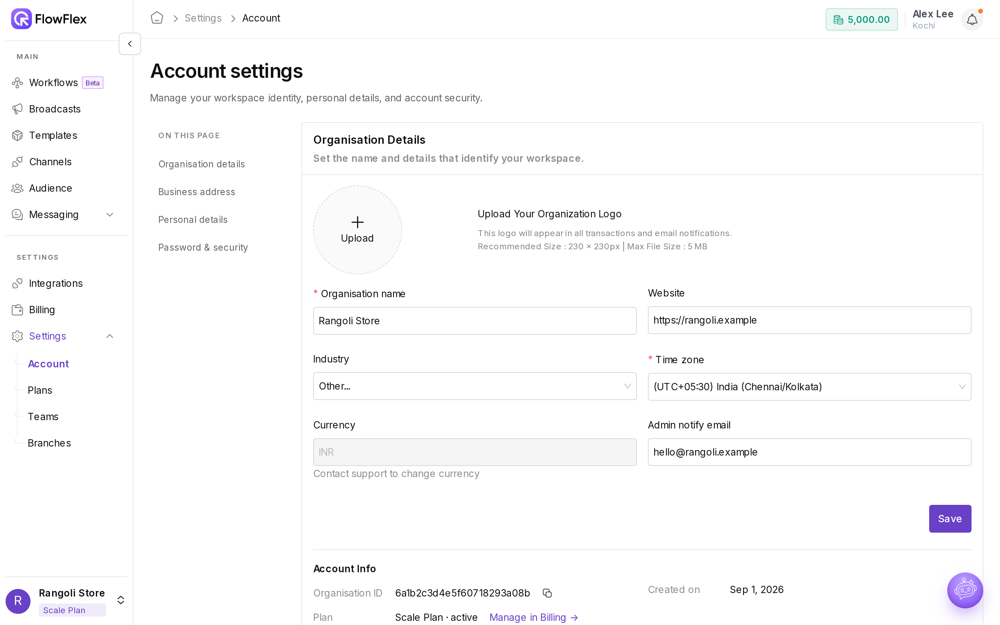

# Organisation and personal settings

Account settings hold the details that appear on your receipts, invoices and email notifications, plus your personal login details. Go to **Settings** → **Account**, or click your name in the top bar and choose **Account settings**. Admins see every section. Agents see **Personal Settings** and **Change Password** only.

When Rangoli Store set up FlowFlex, Alex Lee added the shop's logo, website and time zone, then verified a phone number so FlowFlex could reach Alex on WhatsApp.

## Organisation Details

| Field                  | Rule                                                                                                           |
| ---------------------- | -------------------------------------------------------------------------------------------------------------- |
| Logo                   | JPG or PNG, under 5 MB. Recommended size 230 × 230 px. It appears in all transactions and email notifications. |
| **Organisation name**  | Required, such as `Rangoli Store`                                                                              |
| **Website**            | A valid URL starting with `https://`, such as `https://rangoli.example`                                        |
| **Industry**           | Pick from the list                                                                                             |
| **Time zone**          | Required                                                                                                       |
| **Currency**           | Read-only. **Contact support to change currency.**                                                             |
| **Admin notify email** | Optional. A valid email, such as `alex@rangoli.example`.                                                       |

Click **Save** when you're done.

**Account Info** shows the **Organisation ID** (click the copy icon to copy it), **Created on** and **Plan**. **Manage in Billing →** opens [Billing](billing-and-wallet.md).

## Business address

Enter **Address line 1**, **City**, **State** and **Postal code**, then click **Save**. **Country** is fixed to the organisation's country.

Billing can reuse this address. See **Use business address as billing address** in [Billing and wallet](billing-and-wallet.md).

## Personal Settings

Your profile is how your team sees you in FlowFlex.

* **Profile picture:** JPG or PNG, under 5 MB. Preferred size 230 × 230.
* **Name:** your display name.
* **Email:** read-only, because it's your login.
* **Phone number:** include the country code, such as `+919000000001`.

Click **Save** when you're done.

### Verify your phone number

1. Enter your number and click **Verify phone number**. FlowFlex saves the number first.
2. Enter the six-digit code sent to you on WhatsApp.
3. Click **Verify phone number**. The icon next to **Phone number** changes to verified.

The dialog shows **Time remaining** for the code. When it runs out, you see **Code expired. Resend OTP.** Click **Resend OTP** once its timer finishes.

## Change Password

1. Enter your **Current password**.
2. Enter a **New password**. The checklist turns green as each rule is met.
3. Re-enter it in **Confirm password**.
4. Click **Save**.

| Rule                  | Error if missing             |
| --------------------- | ---------------------------- |
| At least 8 characters | **8 characters required**    |
| An uppercase letter   | **Missing uppercase letter** |
| A lowercase letter    | **Missing lowercase letter** |
| A number              | **Missing digit**            |
| No spaces             | **Space not allowed**        |

## Create another organisation

One login can belong to several organisations, each with its own plan, wallet, branches and team.

1. Click the organisation name at the bottom left of the sidebar.
2. Next to **ORGANISATIONS**, click **+**. The setup screen opens.
3. Fill in **Business details**: **Business name**, **Website** (optional), **Country of residence**, address, **State**, **City**, **Time zone** and **Postal code**. The currency follows the country.
4. Fill in **About you & your business**: your role (optional), industry, and how you found FlowFlex.
5. Finish the setup. You land in the new organisation.

## Switch organisation

1. Click the organisation name at the bottom left. The menu shows the current organisation and its plan tag, such as **Growth** or **Trial Plan**.
2. Under **ORGANISATIONS**, click the one you want to open. Each entry shows its plan tag.

> \[!TIP] Switching organisation reloads the app with that organisation's data. Check the name at the bottom left before you send a broadcast.

## See also

* [Billing and wallet](billing-and-wallet.md)
* [Branches](branches.md)
* [Teams](teams.md)
