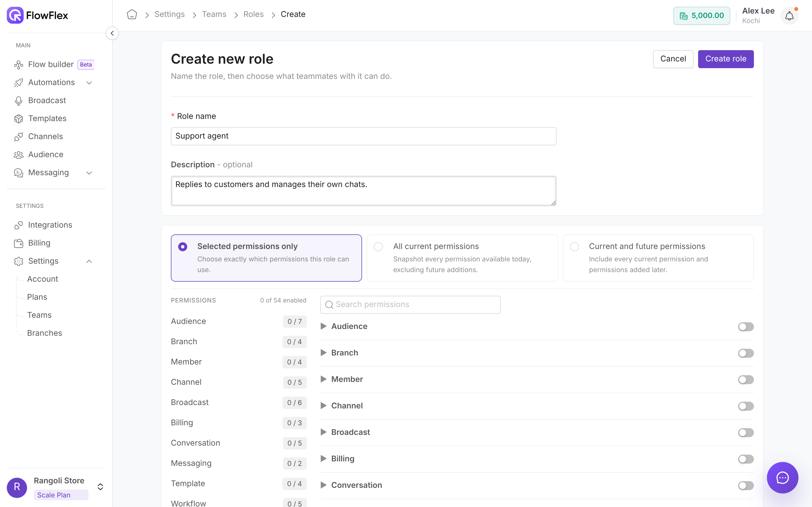

# Roles and permissions

A role is a named set of permissions. Every team member gets one role, and the branches and channels you give them in [Teams](teams.md) limit where the role applies. Members see only the pages and actions their role allows.

At Rangoli Store, Chris Taylor answers chats and doesn't need to see broadcasts or billing. Alex Lee creates a **Support agent** role with just the chat and contact permissions, and gives it to Chris.

Go to **Settings** → **Teams** → **Roles** to create and manage roles.

## The Admin role

Every organisation has an **Admin** role with **Full control**. It can do everything, including Billing, Plans, Teams and Branches.

Admin is a default role: **Default roles cannot be edited** and **Default roles cannot be deleted**. You can copy it.

## Create a role

<figure><figcaption>
Creating the Support agent role
</figcaption></figure>

1. Click **Create New Role**.
2. Enter a **Role name**, such as `Support agent`. Up to 30 characters.
3. Optional: enter a **Description**, such as `Answers customer chats`. Up to 200 characters.
4. Choose a permission mode. See [Permission modes](roles-and-permissions.md#permission-modes).
5. For **Selected permissions only**, open each group and turn on the permissions you need. Use **Search permissions** to find one. A group's switch turns on all its permissions.
6. Click **Create role**.

The left panel shows **N of M enabled** and a count for each group. If nothing is selected, you see **Please select at least one permission.**

### Permission modes

* **Selected permissions only:** exactly the permissions you turn on.
* **All current permissions:** every permission that exists today. Permissions added later aren't included.
* **Current and future permissions:** every permission today and any added later.

> \[!NOTE] **Current and future permissions** gives the role everything, including any permission FlowFlex adds later, the same as Admin. Billing, Plans, Teams and Branches are included. Pick **All current permissions** if new features shouldn't be granted automatically.

## Copy, edit or delete a role

The roles list shows each role's **Name**, **Created Date**, **Last updated** and **Permissions**. Use **Search by name** to find one.

* **Copy:** click **Copy role**. **Copy role** opens with the name `Copy of …`. Click **Create copy**.
* **Edit:** click **Edit role**, make your changes, and click **Update role**. Changes apply to everyone with the role.
* **Delete:** click **Delete role**, then **Yes**. Default roles can't be deleted.

## Permissions

Permissions are grouped as they appear on the role screen.

| Group        | Permission                  | Allows                                                                    |
| ------------ | --------------------------- | ------------------------------------------------------------------------- |
| Audience     | **Audience view**           | Open **Audience** and see contacts, lists and segments                    |
|              | **Audience create**         | Add contacts                                                              |
|              | **Audience edit**           | Edit contacts, lists, segments and tags                                   |
|              | **Audience delete**         | Delete contacts                                                           |
|              | **Audience import**         | Import contacts from a file                                               |
|              | **Audience export**         | Export contacts                                                           |
|              | **Audience assign**         | Assign contacts to team members                                           |
| Conversation | **Conversation view**       | Open **Messaging** → **Conversations** and read chats                     |
|              | **Conversation view all**   | See every conversation in their branches and channels, not just their own |
|              | **Conversation reply**      | Send replies                                                              |
|              | **Conversation assign**     | Assign a conversation to a team member                                    |
|              | **Conversation reassign**   | Move a conversation that is already assigned                              |
| Messaging    | **Messaging settings view** | Open **Messaging** → **Settings**                                         |
|              | **Messaging settings edit** | Change messaging settings                                                 |
| Branch       | **Branch view**             | View branches                                                             |
|              | **Branch create**           | Create branches                                                           |
|              | **Branch edit**             | Edit branches                                                             |
|              | **Branch delete**           | Delete branches                                                           |
| Channel      | **Channel view**            | Open **Channels**                                                         |
|              | **Channel create**          | Connect a new channel                                                     |
|              | **Channel edit**            | Change channel settings                                                   |
|              | **Channel delete**          | Remove a channel                                                          |
|              | **Channel assign**          | Assign channels                                                           |
| Template     | **Template view**           | Open **Templates**                                                        |
|              | **Template create**         | Create templates                                                          |
|              | **Template edit**           | Edit templates                                                            |
|              | **Template delete**         | Delete templates                                                          |
| Broadcast    | **Broadcast view**          | Open **Broadcasts** and see results                                       |
|              | **Broadcast create**        | Create broadcasts and drafts                                              |
|              | **Broadcast edit**          | Edit broadcasts                                                           |
|              | **Broadcast delete**        | Delete broadcasts                                                         |
|              | **Broadcast publish**       | Publish a broadcast so it sends                                           |
|              | **Broadcast export**        | Export broadcast reports                                                  |
| Workflow     | **Workflow view**           | Open **Workflows** and its **Flows** tab                                  |
|              | **Workflow create**         | Create flows                                                              |
|              | **Workflow edit**           | Edit flows                                                                |
|              | **Workflow delete**         | Delete flows                                                              |
|              | **Workflow publish**        | Publish flows so they run                                                 |
| Campaign     | **Campaign view**           | Open **Workflows** → **Workers**                                          |
|              | **Campaign create**         | Create workers                                                            |
|              | **Campaign edit**           | Edit workers                                                              |
|              | **Campaign delete**         | Delete workers                                                            |
|              | **Campaign launch**         | Activate workers                                                          |
| Member       | **View Team Members**       | View team members and their access setup                                  |
|              | **Invite Team Members**     | Invite new members                                                        |
|              | **Edit Team Members**       | Change a member's role and access                                         |
|              | **Remove Team Members**     | Remove members                                                            |
| Billing      | **Billing view**            | View billing                                                              |
|              | **Billing manage**          | Manage billing                                                            |
|              | **Billing export**          | Export billing                                                            |
| Integration  | **Integration view**        | Open **Integrations**                                                     |
|              | **Integration create**      | Add integrations                                                          |
|              | **Integration edit**        | Change integrations                                                       |
|              | **Integration delete**      | Remove integrations                                                       |

Workers used to be called campaigns, so their permissions are still named **Campaign** on the Roles page. If you don't see **Workflows** or its **Flows** tab with **Workflow view**, contact FlowFlex support.

More on each area: [Audience](../audience/overview.md), [Conversations](../messaging/conversations.md), [Messaging settings](../messaging/settings.md), [Connect a WhatsApp channel](../whatsapp/connect-channel.md), [Create a template](../whatsapp/create-template.md), [Send a broadcast](../broadcasts/send-broadcast.md) and [Workers](../flows/workers.md).

## Example roles

### Support agent

Chris Taylor answers customer chats at the Kochi store. The **Support agent** role turns on:

* **Conversation:** **Conversation view**, **Conversation reply**, **Conversation assign**
* **Audience:** **Audience view**, **Audience edit**
* **Template:** **Template view**
* **Messaging:** **Messaging settings view**

In [Teams](teams.md), Chris gets **Selected branches only** → **Kochi** and **Selected channels only** → the Kochi number. Chris sees **Messaging**, **Audience** and **Templates**, and only Kochi chats.

### Marketing manager

Jordan Brown plans broadcasts and workers for both stores. The **Marketing manager** role turns on:

* **Audience:** **Audience view**, **Audience create**, **Audience edit**, **Audience import**, **Audience export**
* **Template:** **Template view**, **Template create**, **Template edit**
* **Broadcast:** **Broadcast view**, **Broadcast create**, **Broadcast edit**, **Broadcast publish**, **Broadcast export**
* **Workflow:** **Workflow view**
* **Campaign:** **Campaign view**, **Campaign create**, **Campaign edit**, **Campaign launch**
* **Channel:** **Channel view**

Jordan gets **All current branches** or **Current and future branches**. With **Campaign view**, Jordan sees **Workflows** → **Workers**; **Workflow view** adds the **Flows** tab.

> \[!TIP] Start from the smallest set of permissions. Add more when someone hits a page they need.

## See also

* [Teams](teams.md)
* [Branches](branches.md)
* [Conversations](../messaging/conversations.md)
