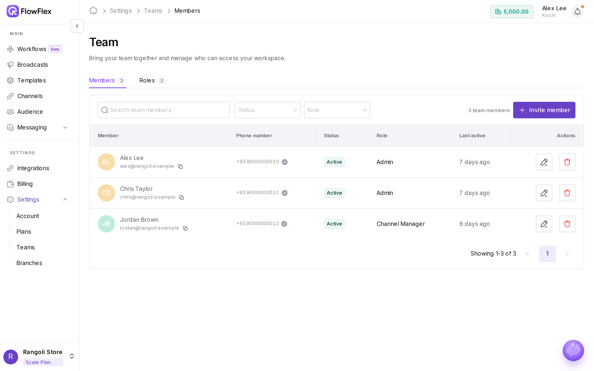
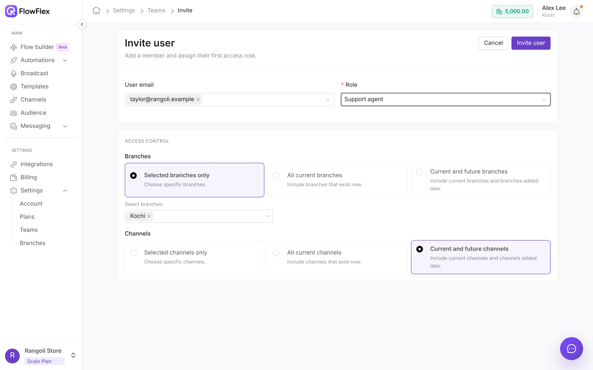

# Teams

Teams controls where someone works. What they can do there comes from their role; see [Roles and permissions](roles-and-permissions.md). Go to **Settings** → **Teams**. Only Admins see this page in the sidebar. The page has two tabs: **All Users** and **Roles**.

Rangoli Store's team is small. Alex Lee is the Admin. Chris Taylor answers customer chats for the Kochi store, and Jordan Brown, the marketing manager, plans broadcasts for both stores. When the Kochi store got busier, Alex invited Taylor Morgan to help Chris with the chats.

## All Users

Each row shows a member's name and email (click the copy icon to copy the email), **Phone number** and whether it's verified, **Role** (or **No role**), and **Last active**, which reads **Never** for people who haven't joined yet.

**Status** is one of:

* **Active:** the person has joined.
* **Invited:** the invitation hasn't been accepted yet.
* **Invite expired:** the invitation link ran out before it was used.
* **Disabled by Plan:** your organisation has more users than your plan allows.

Filter the list with **Search by email or name**, **Status** (**Active**, **Invited**, **Disabled by plan**) and **Role**.

### Actions

The **Actions** column offers:

* **Edit access:** opens **Edit user** for any member.
* **Resend invitation:** sends a new invitation email when the status is **Invited**.
* **Cancel invitation:** removes an invitation when the status is **Invited**.
* **Delete user:** removes an active member from this organisation.

You can't edit or remove yourself or the organisation owner. Members marked **Disabled by Plan** can't be edited until your plan has room for them.

## Invite a user

Alex invites Taylor Morgan to answer Kochi chats.

1. Click **Invite User**, or click your name at the top right and choose **Invite a user**. FlowFlex first checks that your plan has room for another user.
2. In **User email**, type one or more addresses, such as `taylor@rangoli.example`. Separate several with a comma or space.
3. Pick a **Role**, such as **Support agent**.
4. Under **Access Control**, set **Branches** and **Channels**. See [Branch and channel access](teams.md#branch-and-channel-access).
5. Click **Invite user**. You see **Successfully sent an invitation to … with the role: ….**

The invitation link is valid for 24 hours. After that, the status shows **Invite expired**; click **Resend invitation** to send a new one.

### Branch and channel access

**Branches** and **Channels** each offer three options:

* **Selected branches only** / **Selected channels only:** only the ones you pick. Pick at least one.
* **All current branches** / **All current channels:** everything that exists today. Branches or channels added later aren't included.
* **Current and future branches** / **Current and future channels:** everything today, plus anything created later.

The channel list shows each number with its branch name.

Taylor Morgan, like Chris Taylor, gets the **Support agent** role, **Selected branches only** → **Kochi**, and **Selected channels only** → the Kochi number. Taylor sees Kochi chats and nothing from Bengaluru. Jordan Brown works across both stores, so Jordan has **Current and future branches**, and a new store would appear for Jordan without any change.

## Edit a user

1. Click **Edit access** on the member's row.
2. Change **Name**, **Role**, **Branches** or **Channels**. **User email** can't be changed.
3. Admins can also set and verify the member's **Phone number**.
4. Click **Update user**.

## Limits and messages

| Message                                                                          | Cause                                       | Fix                                                                                          |
| -------------------------------------------------------------------------------- | ------------------------------------------- | -------------------------------------------------------------------------------------------- |
| **User limit reached. You can purchase additional users for … each in Billing.** | All user seats are in use                   | Add **Additional Users** on [Plans](plans-and-add-ons.md). FlowFlex opens **Plans** for you. |
| **User limit reached. Please upgrade your plan to add more users.**              | Your plan has no user add-on                | Upgrade on [Plans](plans-and-add-ons.md)                                                     |
| **Cannot invite N users. Your … plan allows only … users.**                      | You invited more people than you have seats | Invite fewer people, or add seats                                                            |
| **Select at least one branch.** / **Select at least one channel.**               | **Selected** is chosen with nothing picked  | Pick one, or choose another option                                                           |
| **Invalid email: …**                                                             | An address is mistyped                      | Correct the address                                                                          |

> \[!NOTE] Removing a user or cancelling an invitation can't be undone. To bring the person back, invite them again.

## See also

* [Roles and permissions](roles-and-permissions.md)
* [Branches](branches.md)
* [Plans and add-ons](plans-and-add-ons.md)
