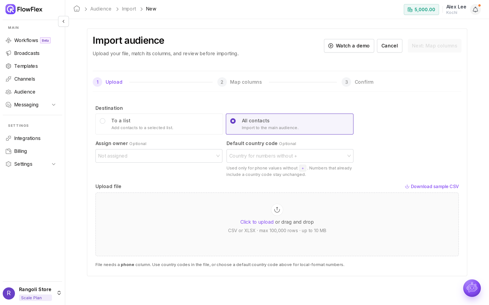
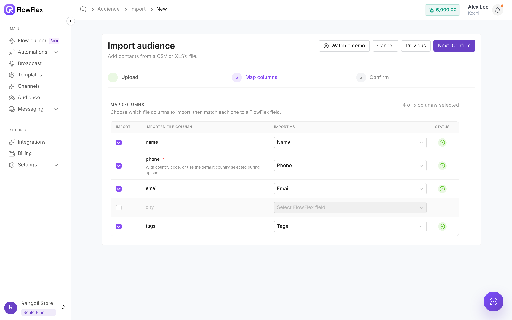

# Import and export contacts

Add many contacts at once from a CSV or XLSX file, and download contacts as a CSV.

**Bulk Import** reads a file of contacts, lets you match its columns to FlowFlex fields, and adds the contacts to your audience, and to a list if you choose. **Export** creates a CSV of the contacts you pick, ready to download.

Rangoli Store keeps its customers in a spreadsheet with a `city` column. Alex Lee uploads it to the Kochi branch, sends the contacts to the list `Repeat buyers – Oct 2026`, and keeps `city` as a custom field so the team can later build a segment of Kochi customers.

## Prepare your file

| Rule | Limit |
| --- | --- |
| Format | CSV or XLSX. For XLSX, only the first sheet is read. |
| Rows | Up to 100,000 data rows |
| Size | Up to 10 MB |
| Header row | Required. The first row must hold the column names. |
| Phone column | Required. Every contact needs a phone number. |

Click **Download sample CSV** on the **Upload** step for a ready-made template. Rangoli Store's file looks like this:

```csv
name,phone,email,tags,city
John Smith,+919000000001,john@rangoli.example,"repeat-buyer",Kochi
Jane Doe,9000000002,,"repeat-buyer,new",Chennai
Sam Wilson,+919000000003,,new,Kozhikode
```

Separate several tags in one cell with commas. Jane Doe's number has no `+`, so it needs a default country code.

## Import contacts

Go to **Audience** → **Bulk Import** → **Import**. The **Import audience** wizard has three steps: **Upload**, **Map columns** and **Confirm**. To see the wizard in action first, click **Watch a demo** on the Import History page.

### Step 1: Upload



1. Choose the **Destination**:
    - **All contacts**: import to the main audience. This is the default.
    - **To a list**: add the contacts to a list too. Pick it in **Select list**, or click **+ Create new list**. A list name can have up to 80 characters.
2. **Assign owner** (optional): pick a team member to own every imported contact. Leave **Not assigned** to skip.
3. **Default country code** (optional): pick a country for numbers written without `+`. Numbers that already include a country code stay unchanged.
4. Drop the file on the box, or click **Click to upload**. FlowFlex previews the first rows.
5. Check the summary under the preview, then click **Next: Map columns**.

The summary tells you what will happen:

- **Phone column detected: phone** means FlowFlex found the phone column by its name.
- **No phone column auto-detected. Map the phone column in the next step.** means you choose the phone column yourself in step 2.
- **N unique rows ready to import** counts rows with a valid, unique phone number.
- **N local-format numbers will use India (+91)** means numbers without `+` get the default country code.
- **N local-format numbers have no default country code selected.** means you should pick a **Default country code**, or these rows may be skipped.
- **N rows have an invalid or non-mobile phone number — they will be skipped.** Fix these numbers in the file, or accept that they're skipped.
- **N duplicate phone rows already appear earlier in the file — they will be skipped.** Only the first row for each number is imported.

To use a different file, click **Replace**.

If the file can't be used, you see one of these errors. Click **Try a different file** to start again.

| Error | Cause | Fix |
| --- | --- | --- |
| **Unsupported file format** | The file isn't CSV or XLSX | Save it as CSV or XLSX |
| **File too large** | Over 10 MB | Split the file and import in batches |
| **Too many rows** | Over 100,000 rows | Split the file and import in batches |
| **No data rows** | Headers but no contacts | Add at least one contact |
| **Couldn't read the file** | No header row, or the file is damaged | Check the header row and save the file again |

### Step 2: Map columns



Each column in your file is one row here, and FlowFlex matches common column names for you. The counter shows how many columns are selected, such as **4 of 5 columns selected**, and the **Status** column shows a tick when a column is mapped.

1. Tick **Import** for each column you want. Unticked columns are skipped.
2. In **Import as**, pick the FlowFlex field for each column.
3. Make sure one column is imported as **Phone**. Until then you see **Phone is required. Check the phone column and import it as Phone before continuing.**
4. Click **Next: Confirm**.

| FlowFlex field | Column names matched automatically | Notes |
| --- | --- | --- |
| **Phone** | phone, phone number, mobile, mobile number, telephone, tel, whatsapp, whatsapp number, contact number, contact | Required. With country code, or use the default country. |
| **Name** | name, full name, contact name, first name, display name | |
| **Email** | email, email address, email id, mail | Invalid emails are left empty |
| **Country** | country, country name | |
| **State** | state, region, province | |
| **Note** | note, notes, comment, comments, remarks | |
| **Tags** | tags, tag, labels, label | Comma-separated. Missing tags are created. |
| **Address line 1** | address, address 1, address line 1, street | |
| **Address line 2** | address 2, address line 2 | |
| **WhatsApp marketing consent** | whatsapp consent, whatsapp marketing consent, whatsapp subscribed | `no`, `false`, `0`, `n`, `opt-out`, `opted out`, `unsubscribe` or `unsubscribed` means off. Anything else, or empty, means on. |
| **Custom field** | Any other column | Creates a custom field. See below. |

Matching ignores capitals, spaces and punctuation, so `Mobile Number` matches **Phone**.

When you map **Country**, you can tick **Use this country column to detect phone country codes**. Numbers without `+` then use each row's country.

#### Keep other data as custom fields

Pick **Custom field** to keep any other data, such as `city` or `last_order_date`.

1. In **Import as**, choose **Custom field**.
2. Check the **Custom field name**. FlowFlex suggests one from the column name, in lowercase with underscores.
3. Change it if needed.

The custom field is created when the import runs. It then appears as a column in **Profiles**, on the contact's **Other** tab, and as a field in filters and [segments](segments.md). Custom fields created by an import are text fields.

You can't use names already used by built-in fields, such as phone or email. You see **"name" is reserved — it would collide with a built-in field. Pick a different name.**

### Step 3: Confirm

1. Check the mappings, listed as **Your imported headers** and **FlowFlex profile headers**. Click **Previous** to change anything.
2. Click **Import contacts**. You see **Import queued** and how many contacts are on the way.
3. Click **Done**.

FlowFlex sends a notification when the import finishes, with a link to download any rows that couldn't be imported. If you see **Import didn't start**, your file and mapping are kept; click **Retry**.

## Contacts that already exist

A row whose phone number already exists in the branch doesn't create a new contact. Instead:

- **Destination list:** the contact is added to the list.
- **Owner:** set to the **Assign owner** choice, if you picked one.
- **WhatsApp consent:** not changed, unless the consent column says `no`, which turns it off.
- **Name, email, tags and other fields:** not changed.

> [!NOTE]
> An import never re-subscribes a contact who opted out. FlowFlex keeps the opt-out even if the contact appears in a later import with `yes`. The contact can subscribe again only themselves, for example by sending the START keyword.

## Skipped rows

A row is skipped when:

- **It has no phone number:** the phone cell is empty.
- **The phone number is invalid:** it has the wrong number of digits, or no country code and no default country.
- **It's a duplicate:** the same number appears in an earlier row of the file.

## Import History

The **Bulk Import** tab lists past imports with their **Name**, **Audience count** (contacts added or updated), **Status** and **Import date**. The status is **Pending** while the import runs, **Completed** when it's done, or **Failed**. Search with **Search by file name**, and click **Refresh** to update statuses.

From each row you can download the original file, download the error file (red icon) when rows were skipped, or delete the record from the ⋯ menu. The error file is a CSV of the skipped rows with an extra `error` column: fix the rows and import that file again.

> [!TIP]
> To create a list from a file while building a broadcast, use **Quick Import** in [Send a broadcast](../broadcasts/send-broadcast.md). It follows the same file rules.

## Export contacts

Exports run in the background, and you get a notification when the file is ready. Start one from where your contacts are:

- **Selected contacts, or all contacts that match a filter:** in **Profiles**, select contacts (or **Select All**), then **More actions** → **Export** → **Confirm**.
- **One list:** open the list, then ⋯ → **Export list** → **Confirm**.
- **One contact:** open the contact, then ⋯ → **Export profile**.

To download it, go to **Audience** → **Export**. The **Export List** table shows each export's **Name**, **Audience count**, **Status** and **Export date**. Click the download icon to get the CSV, or delete the record from the ⋯ menu. Search with **Search by file name**, and to delete several records, select them and choose **Delete Selected**.

The CSV holds the contacts' main fields, such as name, phone, email, marketing consent and tags.

> [!WARNING]
> Exports contain personal data. Store and share them only as your privacy policy allows.

## See also

- [Contacts](contacts.md): add or edit one contact at a time.
- [Lists](lists.md): manage the lists you import into.
- [Segments](segments.md): group imported contacts by custom fields such as `city`.
- [Send a broadcast](../broadcasts/send-broadcast.md): send to the contacts you imported.
