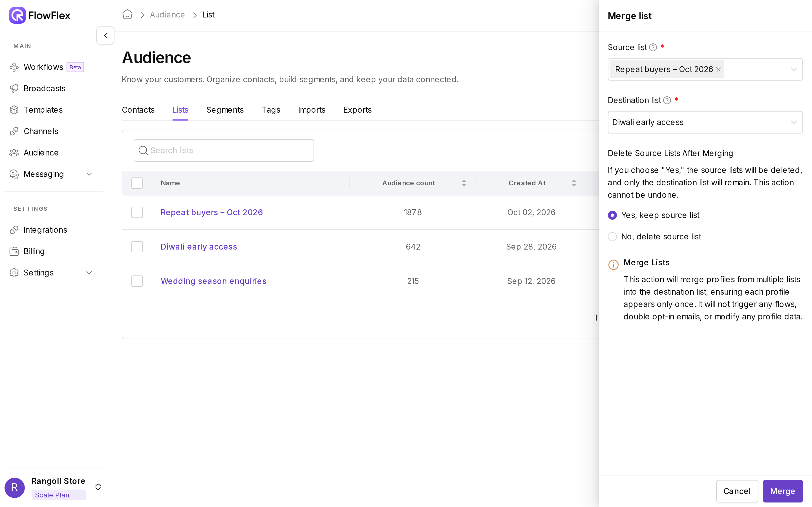

# Lists

Pick a fixed group of contacts by hand, then send broadcasts to it or use it in segments.

A list holds exactly the contacts you put in it. Contacts join only when you add them, by hand, by bulk action or by import, and they stay until you remove them. To group contacts by a rule that updates on its own, use a [segment](segments.md).

Before the Diwali sale, Jordan Brown at Rangoli Store creates the list `Repeat buyers – Oct 2026`, selects the customers who bought twice in September, including John Smith and Jane Doe, and adds them in one go. The broadcast `Diwali sale – repeat buyers – Oct 2026` then goes to exactly those customers.

Go to **Audience** → **List** to create, merge and manage lists. The table shows each list's name, **Audience count**, **Created At** and **Updated date**, with rename (pencil), delete (bin) and ⋯ buttons at the end of the row. Use **Search list name** to find one.

## Create a list

1. Click **Create new**.
2. Enter a **Title**, such as `Repeat buyers – Oct 2026`.
3. Click **Create list**. The new, empty list appears in the table.

The name can't be empty, and two lists in the same branch can't share a name: you see **List already exists**.

You can also create a list on the spot:

- In Profiles → **More actions** → **Add to list**, type a new name and pick **+ Create new list: "name"**.
- In **Bulk Import**, choose **To a list** → **+ Create new list**. See [Import and export](import-export.md).

## Add and remove contacts

- **Add many contacts:** in **Profiles**, select them, then **More actions** → **Add to list**.
- **Add one contact:** open the contact, then ⋯ → **Add to list**.
- **Add a new contact:** open the list, then ⋯ → **Quick add**. Fill in the form and click **Create profile**.
- **Import contacts:** in **Bulk Import**, choose **To a list** and pick the list.
- **Remove many contacts:** in **Profiles**, select them, then **More actions** → **Remove from list**.
- **Remove one contact:** open the contact, go to the **List** tab, and click the bin icon.

Adding or removing contacts doesn't change their subscription status, and doesn't start any flows.

## Rename or delete a list

- To rename, click the pencil icon, edit the name in **Edit list name**, and click **Confirm**.
- To delete, click the bin icon and confirm with **Yes**. To delete several, select them, then **More actions** → **Delete**.

Deleting a list doesn't delete its contacts.

## Merge lists

Merging copies every contact from one or more source lists into a destination list. Each contact appears only once in the destination. Rangoli Store, for example, could merge `Repeat buyers – Oct 2026` into a year-round loyalty list after the sale.

1. In the List table, click ⋯ → **Merge list** on a source list, or open the list and choose ⋯ → **Merge list**.
2. **Source list**: the list you clicked is filled in. Add more lists if needed.
3. **Destination list**: pick the list that receives the contacts. It can't also be a source: **Can't be the same source and destination.**
4. Under **Delete Source Lists After Merging**, choose:
    - **Yes, keep source list**: the source lists stay as they are. This is the default.
    - **No, delete source list**: the source lists are deleted after the merge. This can't be undone.
5. Click **Merge**. The destination list now holds the contacts from every source list.

Merging doesn't start flows, send opt-in messages or change any contact data.

> [!WARNING]
> Read the two options carefully. The option that deletes the source lists starts with "No". If you choose it, only the destination list remains.

## Subscribe or unsubscribe a list

These actions change marketing consent for everyone in the list right now.

1. In the List table, click ⋯ → **Subscribe audience** or **Unsubscribe audience**. For several lists, select them, then use **More actions**.
2. Click **Confirm**.

**Subscribe audience** turns WhatsApp, SMS and Email consent on for the list's members, and **Unsubscribe audience** turns all three off. Contacts added to the list later aren't affected.

> [!WARNING]
> **Subscribe audience** also re-subscribes contacts who opted out. Use it only for contacts who agreed to receive marketing.

## Open a list

Click a list's name to see its members. The header shows **Total audience** and **Created at**. The **Members** tab lists each contact's name, email, phone number, country and **Created At** date; search it with **Search by name, email or phone**.

The ⋯ menu on the list page has:

- **Export list:** starts a CSV export of the list's members. Download it from the [Export tab](import-export.md#export-contacts).
- **Quick add:** creates a new contact directly in this list.
- **Merge list:** opens the merge drawer with this list as the source.
- **Delete list:** deletes the list. The contacts stay in your audience.

### Find a list's ID

Integrations and APIs sometimes ask for a list ID. Open the list: the ID is the last part of the page address, after `/audience/list/`.

## See also

- [Send a broadcast](../broadcasts/send-broadcast.md): choose **Audience Type** → **List**.
- [Segments](segments.md): use the **List** field with **Contains** to filter or segment by a list.
- [Import and export contacts](import-export.md): add a file of contacts straight to a list.
