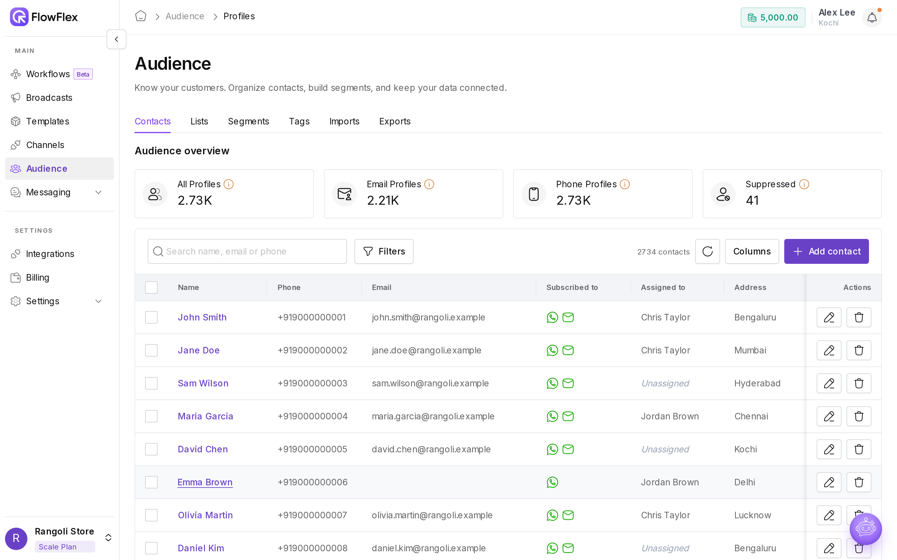

# Audience overview

Audience holds every contact in a branch, with their tags, lists, custom fields and marketing consent. You group contacts in two ways: a **list** is a fixed group you pick by hand, and a **segment** is a rule that FlowFlex keeps up to date as contact data changes. Open it from **Audience** in the sidebar.

Rangoli Store imports its customer spreadsheet into the Kochi branch, tags its best customers `repeat-buyer`, and builds a segment of repeat buyers. When the Diwali sale starts, it sends one broadcast to that segment, and customers who opted out of WhatsApp marketing are skipped.

<figure><figcaption>
The Audience page with its six tabs and overview cards
</figcaption></figure>

## How it works

1. **Add contacts.** Add them one at a time in **Profiles**, or upload a CSV or XLSX file in **Bulk Import**.
2. **Label them.** Add tags such as `repeat-buyer` or `new`, by hand, in bulk, or from a flow.
3. **Group them.** Put contacts in a list, or build a segment from conditions such as tags, custom fields and broadcast activity.
4. **Reach them.** Pick the list or segment as the audience of a [broadcast](../broadcasts/send-broadcast.md).

## The six tabs

* **Profiles:** see, search, filter, add and edit contacts, and run bulk actions. See [Contacts](contacts.md).
* **List:** group contacts by hand, merge lists, and subscribe or unsubscribe a list. See [Lists](lists.md).
* **Segments:** group contacts by rules. Membership updates on its own. See [Segments](segments.md).
* **Tags:** create and delete tags, and see how many contacts carry each one. See [Tags](tags.md).
* **Bulk Import:** upload a CSV or XLSX file of contacts, and see past imports. See [Import and export](import-export.md).
* **Export:** download finished contact exports. See [Export contacts](import-export.md#export-contacts).

Lists and segments are the two ways to pick an audience for a broadcast. A list changes only when you add or remove contacts, by hand, by bulk action or by import, so it suits a fixed group such as `Repeat buyers – Oct 2026`. A segment updates automatically as contact data changes, so it suits a rule such as "Tags contains repeat-buyer and Country is India".

## Branches keep audience data apart

Every contact, list, segment, tag, import and export belongs to one branch. Audience shows only the data of the branch you have selected.

* The **All profiles** count is the total for the selected branch.
* A phone number can exist once per branch. The same number in Kochi and Bengaluru is two separate contacts.
* If you switch branch while a segment is open, FlowFlex returns you to the segment list.

> \[!NOTE] Switch to the right branch before you import, build a segment or send a broadcast. Contacts in another branch are not included.

## Consent and subscription

Each contact has three marketing consent fields: WhatsApp, SMS and Email. A new contact is subscribed to all three unless you untick the consent box. In an import, only WhatsApp consent can be set to off.

| Consent                    | In filters and segments | Used for                      |
| -------------------------- | ----------------------- | ----------------------------- |
| WhatsApp marketing consent | **WhatsApp subscribed** | WhatsApp marketing broadcasts |
| SMS marketing consent      | **Sms subscribed**      | SMS marketing                 |
| Email marketing consent    | **Email subscribed**    | Email marketing               |

The **Subscribed to** column in Profiles shows a green icon for each channel the contact is subscribed to. On a contact's page, the **Overview** shows **WhatsApp**, **Email** and **SMS** as **Subscribed** or **Not Subscribed**.

When you send a broadcast with a **Marketing** template, contacts with WhatsApp marketing consent turned off are skipped. See [Send a broadcast](../broadcasts/send-broadcast.md).

### What changes consent

| Action                                                            | Where                                   | Effect                                                                                                                                                                                     |
| ----------------------------------------------------------------- | --------------------------------------- | ------------------------------------------------------------------------------------------------------------------------------------------------------------------------------------------ |
| Consent checkbox                                                  | **Add contact** / **Edit contact** drawer | Ticked turns all three on. Unticked turns all three off.                                                                                                                                   |
| **Subscribe** / **Unsubscribe**                                   | Profiles → **More actions**             | Turns all three on or off for the selected contacts                                                                                                                                        |
| **Subscribe audience** / **Unsubscribe audience**                 | **List** tab                            | Turns all three on or off for the list's current members                                                                                                                                   |
| **Subscribe current audience** / **Unsubscribe current audience** | **Segments** tab                        | Turns all three on or off for the segment's current members                                                                                                                                |
| **Suppress profile** / **Restore profile**                        | Contact detail page → ⋯ menu            | Turns all three off, or back on                                                                                                                                                            |
| Bulk Import                                                       | **Bulk Import**                         | For new contacts, a mapped **WhatsApp marketing consent** column sets WhatsApp consent; if it isn't mapped, WhatsApp consent is on. An import never re-subscribes a contact who opted out. |

> \[!WARNING] The subscribe and restore actions re-subscribe contacts who opted out earlier. Use them only for contacts who agreed to receive marketing from you.

### Suppressed contacts

A contact is **Suppressed** when all three consents are off: WhatsApp, SMS and Email. The **Suppressed** card on the Profiles tab counts these contacts in the selected branch.

Suppressed contacts stay in your lists and segments, and marketing broadcasts skip them. To suppress one contact, open it and choose ⋯ → **Suppress profile**. To undo it, choose ⋯ → **Restore profile**.

## Get started

* [Add and manage contacts](contacts.md): add, edit, filter and act on contacts.
* [Import and export contacts](import-export.md): upload a file of contacts, or download a CSV.
* [Create and manage lists](lists.md): group contacts by hand.
* [Build a segment](segments.md): group contacts by rules.
* [Use tags](tags.md): label contacts for filters, segments and flows.

## See also

* [Send a broadcast](../broadcasts/send-broadcast.md): send to a list or segment.
* [Broadcast guidelines](../broadcasts/broadcast-guidelines.md): keep marketing messages welcome.
* [Flows overview](../flows/overview.md): tag and route contacts automatically.
