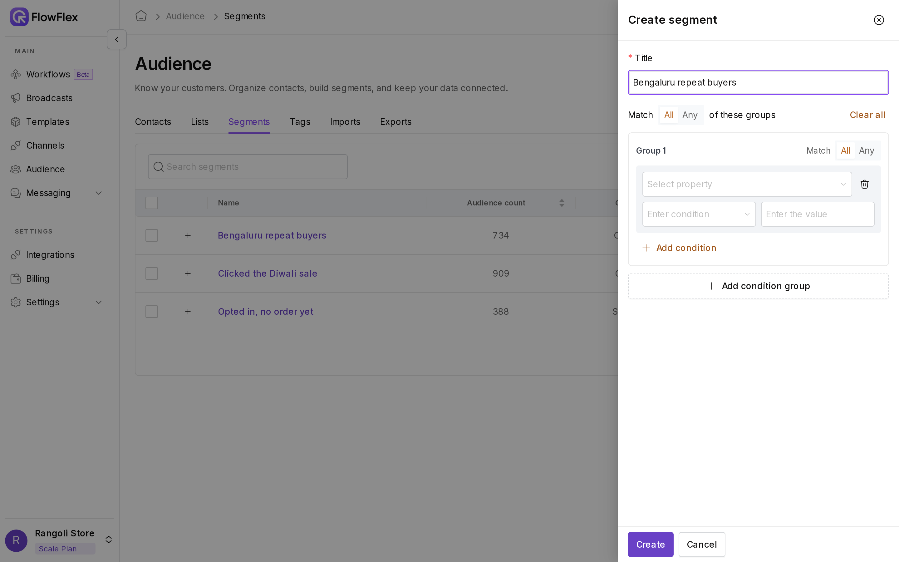

# Segments

A segment is a set of conditions, such as "tagged repeat-buyer and read the Diwali broadcast". FlowFlex finds every contact who matches, and keeps the membership current as tags, lists, contact details and broadcast results change. To pick contacts by hand instead, use a [list](lists.md).

The day after its Diwali broadcast, Rangoli Store creates a segment of repeat buyers who clicked **Shop now**. It sends them a "last day of the sale" reminder, and leaves everyone else alone. More customers click over the next few hours, and the segment picks them up on its own.

Some segments businesses build:

* **Follow up a broadcast:** contacts who **Clicked**, or who **Read**, a particular broadcast.
* **Reward loyal customers:** tag is `repeat-buyer` or `vip`.
* **Welcome newcomers:** contacts created in the last week, or tagged `new`.
* **Run a local offer:** a city custom field equals `Kochi`.
* **Fix your list:** contacts whose message **Failed** with **Message undeliverable**.

Go to **Audience** → **Segments** to create and manage segments.

## Create a segment

1. Click **Create segment**. The **Create segment** drawer opens.
2. Enter a **Title**, such as `Kochi repeat buyers who clicked the Diwali sale`. It needs 2 to 100 characters and must be unique in the branch.
3. Build the conditions. See [Build conditions](segments.md#build-conditions).
4. Click **Create**.

FlowFlex then works out who matches. See [While a segment computes](segments.md#while-a-segment-computes).

## Build conditions

<figure><figcaption>
Building a repeat buyers segment
</figcaption></figure>

Conditions sit inside groups, shown as cards named **Group 1**, **Group 2** and so on. Each condition has three parts: a property, a condition, and a value.

1. In **Group 1**, click **Select property** and pick a field, such as **Tags**.
2. Click **Enter condition** and pick an operator, such as **Contains**.
3. Enter or pick the value, such as `repeat-buyer`.
4. Click **Add condition** to add another condition to the same group, or **Add condition group** to start a new group.

To remove a condition, click its bin icon (**Remove condition**). With two or more groups, each group has a bin icon too (**Remove group**). Click **Clear all** at the top to start over.

Contact filters in **Profiles** and condition steps in flows use the same builder.

### Combine conditions with and and or

You set the logic in two places:

* **Inside a group:** **Match** on the group card decides how its conditions combine. **All** means a contact must meet every condition, and **Any** means one is enough.
* **Between groups:** the top row reads **Match** **All** or **Any** **of these groups**. **All** means a contact must match every group, and **Any** means one group is enough.

The builder shows **and** or **or** between conditions and between groups, so you can read the logic at a glance.

> \[!TIP] To mix "and" and "or", put the "or" conditions in their own group set to **Any**, and leave the top row on **Match All of these groups**. The example below does this.

### Fields

| Field                   | Type               | Notes                                                                                                       |
| ----------------------- | ------------------ | ----------------------------------------------------------------------------------------------------------- |
| **Created At**          | Date               | The date the contact was added                                                                              |
| **Name**                | Text               |                                                                                                             |
| **Tags**                | Tags               | Pick one or more tags. Type a new name and click **Create : name** to create a tag.                         |
| **List**                | Lists              | Pick one or more lists                                                                                      |
| **Broadcast**           | Broadcast activity | What happened to a broadcast sent to the contact. See [Broadcast activity](segments.md#broadcast-activity). |
| **Phone**               | Text               |                                                                                                             |
| **Email subscribed**    | Yes/No             | Email marketing consent                                                                                     |
| **Sms subscribed**      | Yes/No             | SMS marketing consent                                                                                       |
| **WhatsApp subscribed** | Yes/No             | WhatsApp marketing consent                                                                                  |
| **Email**               | Text               |                                                                                                             |
| **Country**             | Text               |                                                                                                             |
| **Assigned to**         | User               | The contact's owner                                                                                         |
| Custom fields           | Usually text       | Fields from imports or integrations. The source shows under the name, such as **Custom**.                   |

Once you pick a field, the condition list shows only the operators for its type.

### Operators

**Text** fields (Name, Phone, Email, Country and text custom fields) offer **Equals to**, **Not Equal to**, **Contains**, **Does Not Contain**, **Starts With**, **Does Not Start With**, **Ends With** and **Does Not End With**. Each comes in a **Case Sensitive** and a **Case Insensitive** version. Case Insensitive treats `Kochi`, `kochi` and `KOCHI` as the same, so use it unless capitals matter.

**Number** custom fields offer **Less than**, **Less than or Equal**, **Equals**, **Not Equals**, **Greater than** and **Greater than or equal**.

**Date** fields (Created At and date custom fields) offer **Before**, **On or Before**, **Equals**, **After** and **On or After**. Pick the day in the date picker.

**Yes/No** fields (the three consent fields) offer **Is True** and **Is False**. No value is needed.

**Tags** and **List** offer **Contains** (has at least one of the selected), **Does not contains** (has none of them), **Is null** (has no tags, or is in no list) and **Is not null**.

**Assigned to** offers **Equals**, **Not Equals**, **In** and **Not In**. The value list includes **Not assigned** for contacts without an owner.

### Broadcast activity

Choose **Broadcast**, pick what happened, then pick the broadcast.

| Operator      | Matches contacts whose message…                                                            |
| ------------- | ------------------------------------------------------------------------------------------ |
| **Sent**      | was sent. Includes delivered and read messages.                                            |
| **Delivered** | was delivered. Includes read messages.                                                     |
| **Read**      | was read                                                                                   |
| **Failed**    | failed. You can also pick the failure reasons; each shows how many messages failed for it. |
| **Replied**   | got a reply from the contact                                                               |
| **Clicked**   | had a tracked link clicked by the contact                                                  |

Each operator matches contacts who reached that status. There isn't a "did not read" option.

## Example: repeat buyers in two cities who read the sale

Rangoli Store wants to follow up with repeat buyers in Kochi or Kozhikode who read `Diwali sale – repeat buyers – Oct 2026`. The city is stored in a custom field named `city`, which came from an import.

1. Click **Create segment** and enter the title `Kochi and Kozhikode repeat buyers – read Diwali sale`.
2. Leave the top row on **Match All of these groups**.
3. In **Group 1**, leave **Match** on **All** and add two conditions:
   * **Tags** → **Contains** → `repeat-buyer`
   * **Broadcast** → **Read** → `Diwali sale – repeat buyers – Oct 2026`
4. Click **Add condition group**. In **Group 2**, set **Match** to **Any** and add:
   * **city** → **Equals to Case Insensitive** → `Kochi`
   * **city** → **Equals to Case Insensitive** → `Kozhikode`
5. Click **Create**.

The segment now reads: (tagged repeat-buyer and read the Diwali broadcast) and (city is Kochi or city is Kozhikode).

John Smith, a repeat buyer in Kochi who read the message, joins the segment. Jane Doe read it too but lives in Chennai, so isn't included. Sam Wilson lives in Kozhikode and read it, but is tagged `new` rather than `repeat-buyer`, so Sam isn't in it either.

## While a segment computes

After you create or edit a segment, FlowFlex works out who matches. While it does, the **Audience count** column shows **Updating**, the segment page shows **Computing**, and the **Members** tab says **Segment is computing. Members will refresh when it finishes.** The ⋯ menu is unavailable until it's done. The page refreshes on its own.

## Find and open segments

The Segments table lists each segment with its **Audience count** and **Created At** date. Click **+** to see a segment's conditions without opening it, and use **Search segments** to find one.

Click a segment's name to open it. The **Members** tab lists its contacts, and **Search segment** finds one. The **Conditions** tab shows the saved conditions; click **Edit** there to change them. To rename the segment, click the pencil next to its name.

## Edit a segment

1. Click the pencil icon in the Segments table, or click **Edit** on the segment's **Conditions** tab.
2. Change the title or conditions in the **Update Segment** drawer.
3. Click **Update**.

The segment computes again with the new conditions.

## Subscribe, unsubscribe or delete

From a segment's ⋯ menu:

* **Subscribe current audience** turns WhatsApp, SMS and email consent on for everyone in the segment right now.
* **Unsubscribe current audience** turns all three off.
* **Delete segment** removes the segment. Its contacts stay in your audience.

To do the same for several segments, select them and use **More actions**. Subscribing and unsubscribing only change the contacts in the segment at that moment; people who join later aren't affected.

> \[!WARNING] **Subscribe current audience** also re-subscribes contacts who opted out. Use it only for people who have agreed to receive marketing.

## See also

* [Send a broadcast](../broadcasts/send-broadcast.md): choose **Audience Type** → **Segment**.
* [Audience actions](../flows/nodes/audience-actions.md): tag customers automatically in a flow.
* [Contact-tag conditions](../flows/nodes/contact-tag-conditions.md): route flow contacts by their tags.
