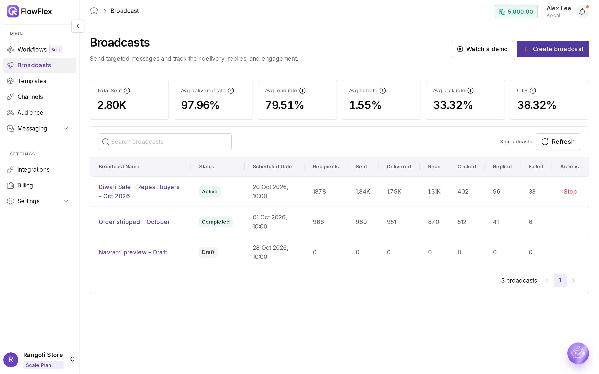
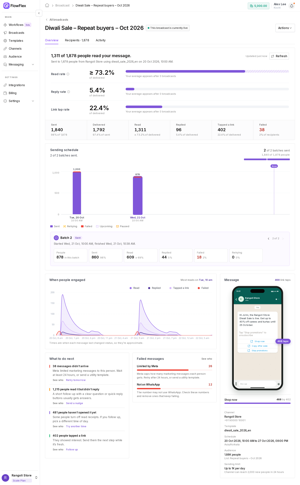
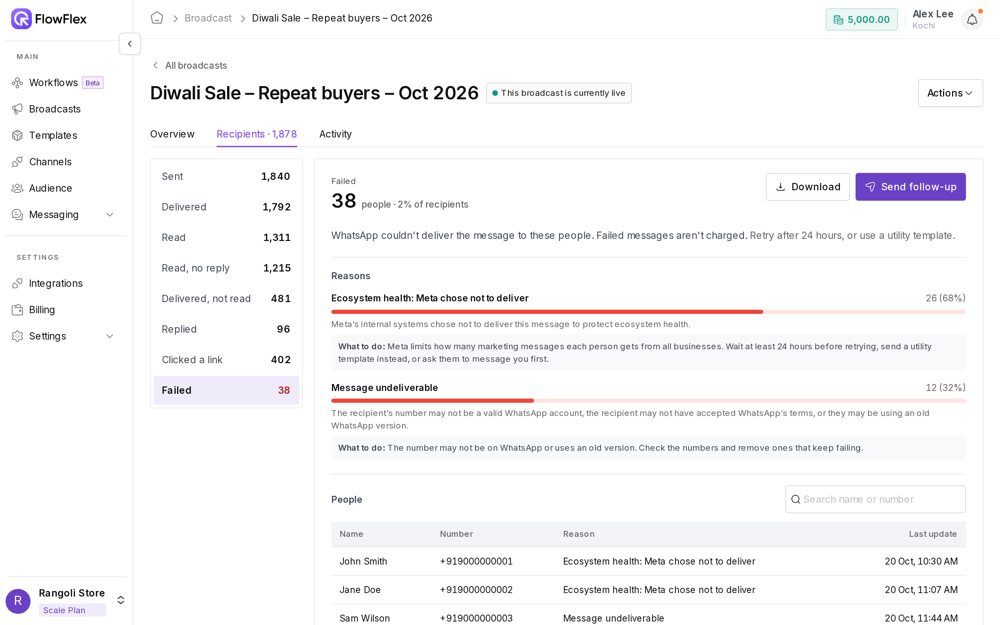

# Results and errors

Open any broadcast to see how it performed, who to follow up with, and why any messages failed. You can also pause, resume or stop the broadcast from the same page.

Every published broadcast has its own report. It starts with a one-line summary, compares your rates with your usual results, shows how sending is going day by day, and suggests what to do next. From the report you can download recipients or create a follow-up broadcast for a group of them.

In this guide, Jordan Brown at Rangoli Store checks "Diwali sale – repeat buyers – Oct 2026" the morning after it starts. Jordan sees that most repeat buyers read the message, finds a handful of failed messages, and creates a follow-up for everyone who tapped **Shop now**.

## The broadcast list

Go to **Broadcasts**. The cards at the top show your results across all broadcasts:

* **Total Sent:** messages sent.
* **Avg delivered rate:** the share of sent messages that were delivered.
* **Avg read rate:** the share of delivered messages that were read.
* **Avg fail rate:** the share of all messages attempted that failed.
* **Avg click rate:** the share of delivered messages whose recipient tapped a link.
* **CTR:** the share of delivered messages whose recipient tapped a link or replied.

Each row shows the broadcast's **Status**, **Scheduled Date**, and its **Recipients**, **Sent**, **Delivered**, **Read**, **Clicked**, **Replied** and **Failed** counts. Use **Search broadcasts** to find one, and **Refresh** to update the numbers. You can stop an Active or Paused broadcast straight from its row.

Click a **Draft** to keep editing it in the create wizard. Click any other broadcast to open its report.

<figure><figcaption>
The Broadcasts list with delivery, read and click stats
</figcaption></figure>

## Statuses

| Status        | Meaning                                                                        |
| ------------- | ------------------------------------------------------------------------------ |
| **Draft**     | Saved but not published. You can still edit it.                                |
| **Active**    | Published and live.                                                            |
| **Paused**    | Sending is on hold, because you paused it or FlowFlex paused it automatically. |
| **Completed** | Finished sending.                                                              |
| **Failed**    | The broadcast couldn't be sent.                                                |
| **Stopped**   | You stopped it permanently. It can't be resumed.                               |

## The report page

The top of the report shows the broadcast's name, its status, and a sentence such as "This broadcast is currently live" or "This broadcast is paused and will resume at…". Use **All broadcasts** to go back to the list.

The buttons on the right depend on the status:

* **Edit broadcast:** shown for a Draft.
* **Replace media:** shown when the broadcast paused because WhatsApp rejected its media.
* **Actions:** **Publish** or **Delete** for a Draft, **Pause** or **Stop** for an Active broadcast, and **Resume** and **Stop**, or only **Stop**, for a Paused one.

Below the header are three tabs: **Overview**, **Recipients** and **Activity**.

## Read the Overview tab

1. **Read the headline.** It sums up the broadcast in one line, for example "820 of 1,000 people read your message.", followed by the channel, the template and the date it was sent. Click **Refresh** for the latest numbers.
2. **Compare the rates.** **Read rate**, **Reply rate** and **Link tap rate** each appear next to **Your average** from your recent broadcasts, with how many points above or below usual this one is. Your average appears after 3 broadcasts. Read rate is shown as "at least", because some people turn off read receipts.
3. **Check the counts.** **Sent**, **Delivered**, **Read**, **Replied**, **Tapped a link** and **Failed** each show how many people reached that point. Click a count to open that group in the **Recipients** tab.
4. **Follow the Sending schedule.** Once sending starts, this card shows how far the broadcast has got, such as "3 of 7 batches sent", and when the next batch goes out. The chart has one bar per daily batch, split into **Sent**, **Retrying** and **Failed**, with shaded bands for any time the broadcast was paused. Click a bar or a pause to see its details, including who paused it and why.
5. **See When people engaged.** This chart shows reads, replies, link taps and failures over time, and the time with the most reads. Times are approximate.
6. **Act on What to do next.** FlowFlex suggests next steps based on the results, each with **See who**:
   * **N messages didn't arrive:** **Retry**, or **Retry tomorrow** when Meta limited delivery.
   * **N people read it but didn't reply:** **Send a nudge**.
   * **N people haven't opened it yet:** **Try another time**.
   * **N people tapped a link:** **Follow up**.

<figure><figcaption>
A broadcast report, Overview tab
</figcaption></figure>

   Each of these creates a follow-up draft (see [Follow up on a broadcast](results-and-errors.md#follow-up-on-a-broadcast)). If there's nothing to suggest, the card says **Nothing needs your attention.**
7. **Check Failed messages.** Failures are grouped by reason, such as **Limited by Meta**, **Not on WhatsApp**, **Template problem**, **Opted out**, **Sending too fast** and **Other reasons**, each with a suggested fix and **See who**. [Common errors](results-and-errors.md#common-errors) explains each reason in detail. Failed messages aren't charged.

The **Message** panel beside the tabs shows the message as customers see it, with the number of taps next to each link button. Below it are the broadcast's settings: **Channel**, **Template**, **Schedule**, **Audience** (including how many contacts were excluded) and **Sending limit**.

Jordan sees "820 of 1,000 people read your message", a read rate above the usual, and 140 taps on **Shop now**. **Failed messages** shows a few contacts under **Not on WhatsApp**, so Jordan opens that group to fix the numbers before the next send.

## See who got the message

The **Recipients** tab lists the people behind each number. Choose a group: **Sent**, **Delivered**, **Read**, **Read, no reply**, **Delivered, not read**, **Replied**, **Clicked a link** or **Failed**.

<figure><figcaption>
A broadcast report, Recipients tab
</figcaption></figure>

Each group shows how many people are in it, what it means, and a tip. The **Failed** group also lists the reasons, with **What to do:** for each one. The table shows each contact's **Name**, **Number**, **Status** and **Last update**; use **Search name or number** to find someone.

* **Download:** save the group as a CSV file. Download is available for most groups.
* **Send follow-up:** create a draft broadcast for everyone in the group.

## Follow up on a broadcast

A follow-up is a new draft broadcast for one group of recipients, such as everyone who tapped a link or everyone who read but didn't reply. Nothing is sent until you choose the message and publish it.

1. In the **Recipients** tab, choose a group and click **Send follow-up**. You can also use an action under **What to do next** on the **Overview** tab.
2. FlowFlex asks **Send a follow-up to "{group}"?** and shows how many people will get it. For the **Failed** group, if Meta limited delivery, wait at least 24 hours before sending, or use a Utility template.
3. Click **Create draft**. The create wizard opens with a draft named after the original broadcast and the group, such as "Diwali sale – repeat buyers – Oct 2026 – follow-up (Clicked a link)". It uses the same channel and time zone, with the group as its audience.
4. Choose the template and the schedule, then publish as usual. See [Send a broadcast](send-broadcast.md).

If the group is empty, FlowFlex shows **No contacts in this group to follow up with**.

Jordan creates a follow-up for **Clicked a link** and schedules a reminder for three days later, so only customers who showed interest hear from Rangoli Store again.

You can also build a [segment](../audience/segments.md#broadcast-activity) with the **Broadcast** field and **Sent**, **Delivered**, **Read**, **Failed**, **Replied** or **Clicked**. A segment is useful when you want to combine broadcast activity with other conditions, or use the same group again later.

## Check the Activity tab

The **Activity** tab is a timeline of what happened to the broadcast and when, such as publishing, pauses and resumes. **All** shows every event, **System** only automatic ones, and **User** only actions your team took.

## Pause, resume or stop a broadcast

To pause an Active broadcast, open **Actions** and click **Pause**. Sending stops until you resume it.

To resume a paused broadcast:

1. Open **Actions** and click **Resume**. The **Resume broadcast** window opens and shows the broadcast's time zone.
2. Leave **Resume time** empty to resume now, or pick a time to schedule it.
3. Click **Resume**. Later daily batches are counted from the resume time.

FlowFlex checks the template and the channel again every time you resume.

To stop a broadcast, open **Actions** and click **Stop**. FlowFlex asks **Stop this broadcast permanently?** Remaining messages, retries and scheduled resumes are cancelled, and messages already submitted to WhatsApp can't be recalled. Click **Stop broadcast** to confirm, or **Keep broadcast** to go back.

> [!WARNING]
> Stopping can't be undone. If you only need time to check something, use **Pause** instead.

## When a broadcast pauses automatically

FlowFlex pauses a broadcast when continuing could harm your number or would fail anyway. The report shows a banner that names the cause and the next step:

* **Broadcast paused: Template quality low:** Meta rated the template as low quality. Edit the template and submit it for review again. You can resume once Meta approves it and its quality is no longer low.
* **Broadcast paused: Template unavailable:** the template can't be sent right now, for example because it's no longer Approved. You can resume once it's Approved again.
* **Broadcast paused: Template disabled:** Meta disabled the template. A disabled template can't be used again, so stop the broadcast and create a new one with a different template.
* **Broadcast paused: Channel quality issue:** your number's quality rating dropped too low. You can resume once the quality recovers. See [Channel quality](broadcast-guidelines.md#channel-quality).
* **Broadcast paused: WhatsApp number unavailable:** the number is blocked, disconnected or restricted. Check its status in WhatsApp Manager. You can resume once the number is available again.
* **Broadcast paused: reupload media:** WhatsApp rejected the media during send. Click **Replace media**, upload a new file, send a test message if you like, then publish again.
* **Broadcast paused by system:** FlowFlex paused the broadcast for another reason. Only **Stop** is available.
* **Broadcast paused: Ready to resume:** the cause of the pause has recovered. Click **Resume** when you're ready.

You can always resume a broadcast you paused yourself. If **Retry failed messages after 48 hrs** is on, the banner also reminds you that failed messages are retried once after 48 hours.

## Common errors

Each failed message has a reason. The **Failed messages** card and the **Failed** group in **Recipients** group them for you. The codes come from [Meta's WhatsApp error codes](https://developers.facebook.com/documentation/business-messaging/whatsapp/support/error-codes).

| Code                  | Shown as                              | Meaning                                                                     | What happens                                                        | What to do                                                     |
| --------------------- | ------------------------------------- | --------------------------------------------------------------------------- | ------------------------------------------------------------------- | -------------------------------------------------------------- |
| 131049                | Ecosystem health                      | Meta held the message back, usually because of its per-user marketing limit | Retried if retry is on                                              | Target better; message the same people less often              |
| 130472                | Recipient in a Meta experiment        | The user is in a Meta experiment                                            | Not retried                                                         | Nothing; this is outside your control                          |
| 131026                | Message undeliverable                 | Not a WhatsApp number, terms not accepted, or an old app version            | Not retried                                                         | Fix or remove the number                                       |
| 131047                | Re-engagement message                 | More than 24 hours since the user last replied                              | Not retried                                                         | Use a template                                                 |
| 131050                | Recipient opted out of marketing      | The customer stopped marketing messages from your business                  | Not retried; the contact's WhatsApp marketing consent is turned off | Nothing; they're left out of future marketing broadcasts       |
| 130429, 131056, 80007 | Rate limit hit                        | Sending throughput reached                                                  | Retried if retry is on                                              | Lower the daily send count                                     |
| 131048                | Spam rate limit hit                   | Sending restricted, often because users blocked or reported you             | Broadcast pauses                                                    | Check quality in WhatsApp Manager; review content and audience |
| 132015 / 132016       | Template paused / disabled            | Low template quality                                                        | Broadcast pauses                                                    | Create an improved template                                    |
| 132001 / 132007       | Template not found / policy violation | Not approved in that language, or breaks policy                             | Broadcast pauses                                                    | Fix or replace the template                                    |
| 131042                | Payment issue                         | Problem with the Meta payment method                                        | Broadcast pauses                                                    | Fix billing in Meta Business Manager                           |
| 131052 / 131053       | Media download / upload error         | Media unreachable, or unsupported type or size                              | Retried automatically                                               | Use **Replace media**                                          |

**Retry failed messages after 48 hrs** tries once more, and only for rate-limit and ecosystem errors (131049, 130429, 131056, 80007). The retry happens only while the broadcast is still within its schedule, so set the end date more than 48 hours after the start.

## See also

* [Send a broadcast](send-broadcast.md)
* [Broadcast guidelines](broadcast-guidelines.md)
* [Segments](../audience/segments.md)
* [Pre-send checklist](checklist-faq.md)
