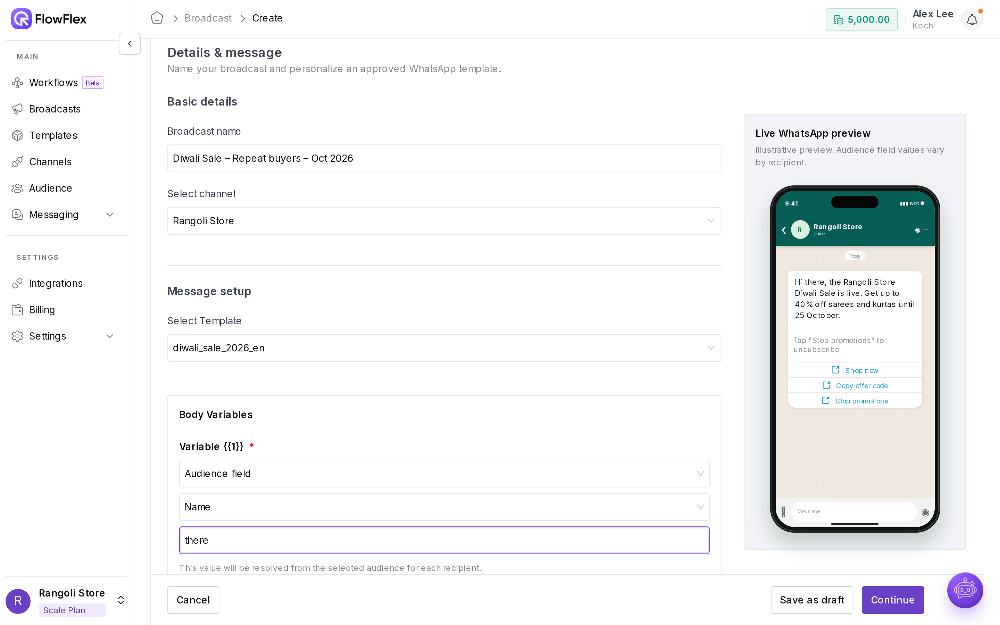
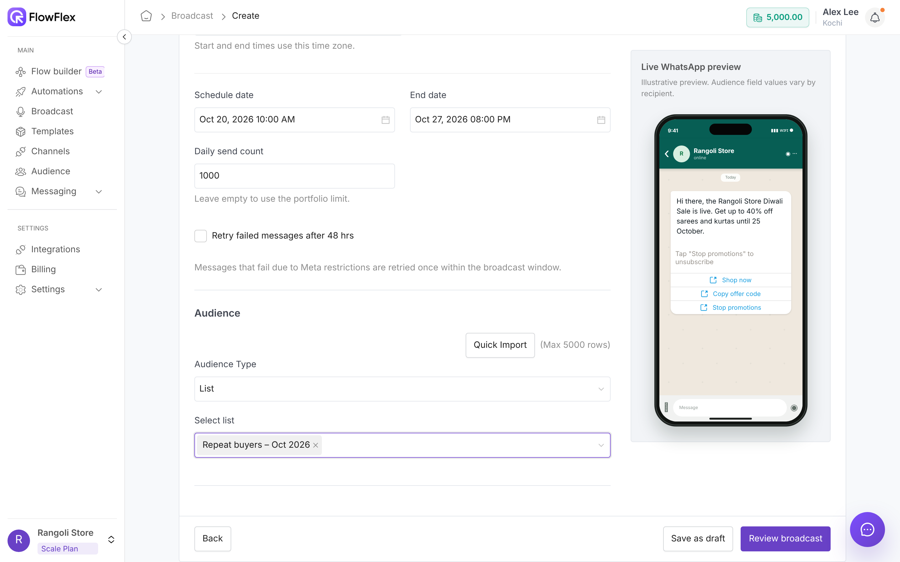
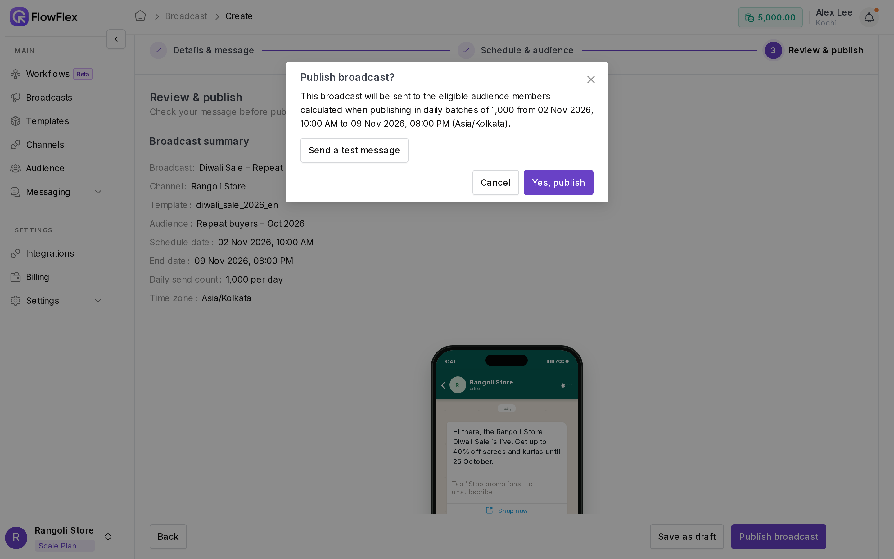

# Send a broadcast

In this guide, Rangoli Store sends its approved Diwali template to repeat buyers. It starts on 20 October at 10:00 AM, greets each person by name, and keeps sending until the sale ends a week later.

Go to **Broadcast** → **Create Broadcast**. The wizard has three steps: **Details & message** → **Schedule & audience** → **Review & publish**. You can **Save as draft** at any step.

## 1. Details & message

<figure><figcaption>
Create broadcast, step 1: Details &amp; message
</figcaption></figure>

1. **Broadcast name**: an internal name, such as `Diwali sale – repeat buyers – Oct 2026`.
2. **Select channel**: Connected channels only.
3. **Select Template**: only **Approved** templates from that channel's WABA are listed.
4. **Map variables** under **Header Variables**, **Body Variables**, and **Button URL Variables**. Each variable is either:
   * **Static text**: the same value for everyone, such as `25 October`.
   * **Audience field**: a contact field, such as Name, Phone, Email, Country, State, or Tags, or any custom field.
5. **Set a fallback** for every Audience field, such as `there` for Name, so the message reads "Hi there" when the name is empty. Tracked URL variables must have a fallback.
6. **Media header**: keep the template's media, or click **Upload Header Image / Video / Document** to use different media for this broadcast. The template's size limits still apply.

## 2. Schedule & audience

<figure><figcaption>
Create broadcast, step 2: Schedule &amp; audience
</figcaption></figure>

Now decide **when** it goes out and **who** gets it.

* **Time zone** (required): the start and end times follow this time zone, so choose the one your customers live in.
* **Schedule date** (required): it can't be in the past, and there's no "send now", so set it a few minutes ahead if you're in a hurry.
* **End date** (required): defaults to one week after the start. Sending stops on this date, even if some contacts haven't been reached yet.
* **Daily send count** (optional): leave it empty to use your channel's Portfolio limit; it can't go higher than that. Contacts are sent in 24-hour batches.
* **Retry failed messages after 48 hrs** (optional): gives messages Meta held back for health or rate limits one more try. The schedule must be longer than 48 hours.
* **Audience Type:** choose **List**, **Segment**, or **Audience** (individual contacts). You can pick more than one.
* **Quick Import:** got a fresh CSV or XLSX file? Upload it here to create a list on the spot. Set **Default country code** for numbers without `+`; invalid, non-mobile and duplicate numbers are skipped for you.

If you see **Some audience members may not receive this broadcast**, the audience is larger than the daily send count × the number of days. Extend the end date or raise the daily count.

For **Marketing** templates, contacts who opted out of WhatsApp marketing are excluded automatically, and FlowFlex shows how many.

## 3. Review & publish

<figure><figcaption>
The Publish broadcast confirmation with a test message
</figcaption></figure>

1. Check the **Broadcast summary**.
2. Click **Publish broadcast**. The confirmation shows the number of eligible contacts, the batch size, and the date range.
3. **Send a test first.** Tick **Send a test message**, enter your own number with the country code, and check the message on your phone: variables, fallbacks, media, buttons, and links.
4. Click **Yes, publish**.

Publishing is blocked if:

* the wallet balance is below the minimum (**Insufficient wallet balance**);
* the template is no longer Approved, or its quality is low;
* the channel is Blocked, or its quality is low;
* a Quick Import is still processing.

## Cost

Each delivered message is paid from your wallet in message credits. Your rates are on the **WhatsApp message charges** page in **Billing**; see [Billing and wallet](../account/billing-and-wallet.md).

## What your customers see

At 10:00 AM on 20 October, John Smith's phone lights up with "Hi John, the Rangoli Store Diwali Sale is live…", along with **Shop now**, an offer code to copy, and an opt-out button. A customer whose name you don't have sees "Hi there" instead. By the next morning, the broadcast shows who read it and who tapped **Shop now**.

## See also

* [Results and errors](results-and-errors.md): what each number and error means.
* [Segments](../audience/segments.md): follow up with everyone who **Clicked** or **Read** this broadcast.
* [Broadcast guidelines](broadcast-guidelines.md): keep your number healthy as you send more.
