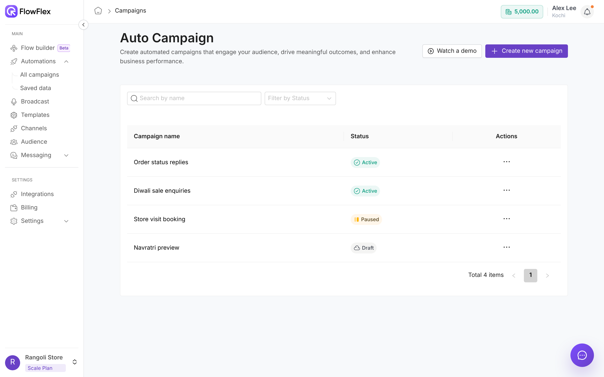

# Campaigns

Switch on a published flow so that customers' incoming WhatsApp messages start it.

> [!NOTE]
> Flow builder is in Beta. If you don't see it in the sidebar, contact FlowFlex support.

A campaign connects a flow to incoming messages on the flow's channel. You find campaigns under **Automations** → **All campaigns**, on the **Auto Campaign** page.

Rangoli Store has published its order-tracking flow. To put it to work, the team creates a campaign called `Rangoli Store – Order help` and selects that flow. From then on, when Jane Doe messages the store, the flow replies with the **Track order** and **Talk to the team** buttons.

## How a campaign works

1. You build a flow whose trigger is **WhatsApp Incoming Chat**, and publish it. See [Choose the trigger](triggers-and-variables.md).
2. You create a campaign for that flow and set its dates.
3. While the campaign is **Active**, a customer's message on the flow's channel starts the flow for that customer.

Each contact goes through a campaign once. A second message from the same contact does not restart it until the campaign's end date passes.

The START and STOP keywords from [Subscription Auto Replies](../messaging/settings.md#subscription-auto-replies) never start a campaign.

To react only to certain words, such as "price" or "offer", set a **Trigger filter** on the flow's incoming-message trigger. See [Choose the trigger](triggers-and-variables.md).

## The campaign list

The list shows each campaign's **Campaign name**, its **Status**, and an **Actions** column with the **⋯** menu. Click a name to open [Campaign Outcomes](campaigns.md#campaign-outcomes).

Use **Search by name** to find a campaign, and **Filter by Status** to show one or more statuses.

### Statuses and actions

| Status | Meaning | **⋯** menu |
| --- | --- | --- |
| **Active** | Incoming messages start the flow. | **Pause**, **Delete** |
| **Paused** | Stopped for now. Nothing starts. | **Resume**, **Delete** |
| **Draft** | Saved, but publishing did not finish. | **Publish**, **Delete** |
| **Completed** | Finished. | **Delete** |

> [!WARNING]
> **Delete** runs at once, with no confirmation. Pause a campaign instead if you may need it again.

If you resume a campaign whose flow is switched off, you see **Campaign not resumed**. Activate the flow under **Flow builder** first, then click **Resume** again.

### Paused by plan

Your plan limits how many flows can be on. If a flow is switched off because the limit is exceeded, its Active campaigns pause automatically. They show **Paused** with **by plan** next to it.

Upgrade your plan or switch off another flow. When the flow comes back on, these campaigns resume by themselves. Campaigns you paused by hand stay paused.

## Create a campaign

Click **Create new campaign**. The wizard has three steps: **Details & flow** → **Duration** → **Review & publish**. Click **Watch a demo** for a short walkthrough first.

### 1. Details & flow

1. Enter a **Campaign name**, such as `Rangoli Store – Order help`. It's required and must be unique in the branch.
2. Optionally add a **Description**, a note for your team.
3. Under **Select flow**, pick the flow. Only active flows with the WhatsApp incoming-message trigger are listed. Use **Search flows** to find one.
4. Check the preview on the right. It shows the flow's published version, read-only. Click **Expand preview** for a larger view.
5. Click **Continue**.

Flows marked **Not published** can't be picked. Publish them first. See [Versions, publishing and JSON files](versions-and-portability.md).

### 2. Duration

1. Pick a **Start date**. It's required.
2. Choose how long it should **Run for**: **1 week** (the default), **2 weeks**, **3 weeks**, **4 weeks**, or **Custom**. FlowFlex shows the end date, such as "Ends 22 Oct 2026".
3. For **Custom**, pick an **End date**. It must be on or after the start date.
4. Click **Review campaign**.

### 3. Review & publish

1. Check the **Campaign summary**: **Campaign**, **Published flow**, **Start date**, and **End date**.
2. Check the flow preview.
3. Click **Publish campaign**.

FlowFlex shows **Campaign published.** and the campaign becomes **Active**. If you see **Campaign saved, but publishing did not finish**, the campaign is kept as a **Draft**. Fix the issue, then use **⋯** → **Publish**.

Publishing fails if the flow is inactive, not published, or switched off by your plan's flow limit.

A campaign runs the flow version that was published when you published the campaign. Later changes to the flow do not reach the campaign on their own.

## Campaign Outcomes

Click a campaign's name to open **Campaign Outcomes**. It shows one row for each time the flow ran for a contact, with the data the flow collected.

- **Select column and search:** pick a column, then search inside it.
- **Filter:** build conditions on the columns, then click **Apply Filter**.
- **Clear All Filters:** removes the search and filters.
- **Show Columns:** choose which columns are shown.
- **Export CSV:** downloads the outcomes.

## See also

- [Build your first flow](building-a-flow.md)
- [Saved data](saved-data.md)
- [Audience actions](nodes/audience-actions.md)
