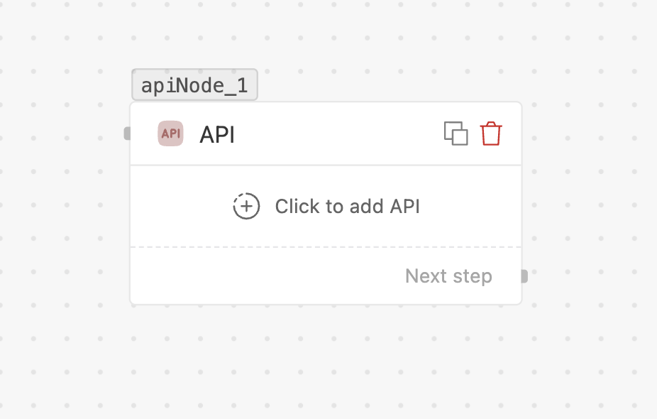

# API

> Connect your workflow to another service, such as an order or booking system.

Use this step to look up an order, check availability, or send information to another system. You will need the API details supplied by that service.

## Set up the request

1. Choose the **Method** and enter the **URL** from the service's instructions.
2. Add any required **Headers**, **Query params**, and **Body**.
3. Use **Insert variable** to include customer details or information from earlier steps.
4. Add a response example so you can select the returned fields in later steps.
5. Connect all three response paths, then save the node.

| Setting | What to enter |
| --- | --- |
| **Method / URL** | The request method and address provided by the service. |
| **Headers** | Details required by the service, such as an API key. |
| **Query params** | Values the service expects in the request URL. |
| **Body** | The information to send. Choose the format required by the service: JSON, form, raw, or none. |

For example, insert the order number from your trigger into an order-status request, then use the returned delivery date in a message.

## Import cURL

If the service supplies a cURL example, open the URL field's actions menu → **Import cURL** and paste it. Review the imported settings and replace example values with your own details or flow variables.

Import fills in the form; it does not send the request.

## Try the request and use its response

Use the drawer's request test with sample values to check the connection. This sends a real request to the service, so use test data when creating or changing records.

Review the result and save it as a response example. You can also add examples manually, including error responses.

In a later message or condition, open **Insert Variable**, select the API node, and choose the returned field you need. Response examples help you find fields; the values used in a real flow come from the service's actual response.

## Choose what happens next

Connect each output to another step or **End**:

| Output | What it means | Example next step |
| --- | --- | --- |
| **Success** | The service accepted the request. | Send the returned order status. |
| **Non-2xx response** | The service returned an error response. | Explain that the order could not be found, or assign an agent. |
| **Request failed** | The service could not be reached or did not respond in time. | Offer help or hand over to an agent. |

A successful request may still return an order that is pending or unavailable. Add a Condition split to check that result before promising the customer it is ready.

## Time limits and retries

Open **Settings** to choose how long the request can wait and whether it should try again. Retries are off by default.

- **Timeout per attempt** limits each request to 1–45 seconds.
- **Overall time limit** limits all attempts and waiting time to a maximum of 10 minutes.
- **Maximum retries** allows up to 9 additional attempts.
- **Retry rate-limited requests** tries again when the service asks you to slow down. You can use the service's suggested wait or choose a retry delay.
- **Retry other HTTP failures** lets you choose which errors should be retried. More options cover connection errors and timeouts.

Choose a fixed wait between retries or an increasing wait. Before enabling retries for bookings, payments, or record creation, check the service's guidance on preventing duplicate actions.

## Updating an older API step

If the drawer offers **Upgrade request** or **Convert to response outputs**, use it to switch to the current settings and three response paths. Review the request and connect every new output before saving and publishing.
