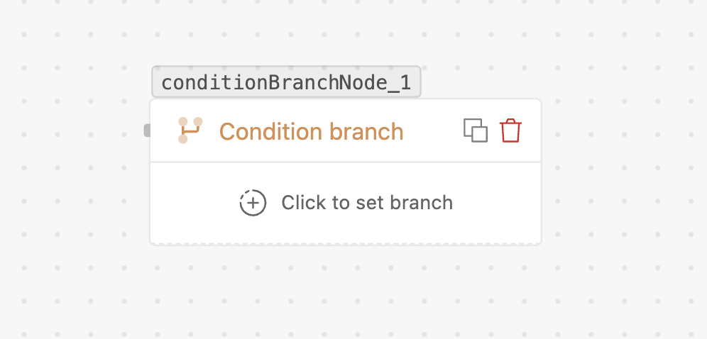

# Condition branch

> A **multi-path** branch — the flow takes the first path whose condition matches.

## What it does

Like a switch statement: you define several **paths**, each with its own condition. The flow
evaluates them **top to bottom** and takes the **first** one that matches. The current drawer exposes the configured paths; it does not add a separate Default output.

## When to use

- More than two outcomes: routing by category, tier, region, status, or a menu selection.

## Settings

- **Paths** — starts with two ("Path 1", "Path 2"); add as many as you need.
- **Per path** — a label and its condition(s), combined with **AND** / **OR** (same
  [operators](flows/nodes/condition-split.md#settings) as Condition split).

## Handles

- **One handle per path** — wire each to its branch.
- Connect every configured path to another step or End.

## Tips

- **Order matters** — the first matching path wins, so put the most specific conditions first.
- If you need an explicit unmatched route, use a Condition split with a No path.

## Live contact tags

Choose Contact tags to use Has any, Has all, or Has none with the current contact. See [Contact-tag conditions](flows/nodes/contact-tag-conditions.md).
