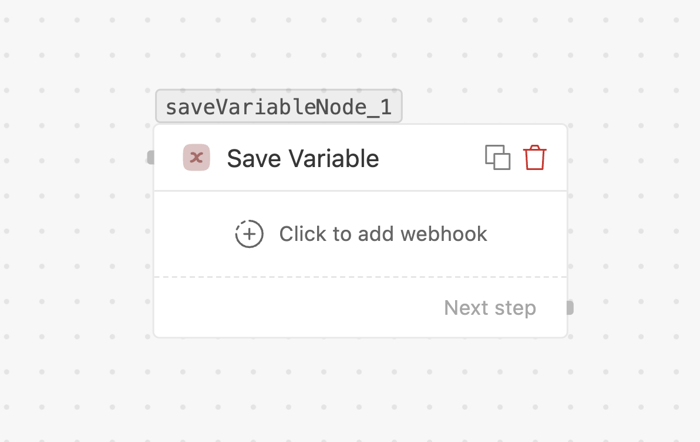

# Save variable

> Store named values for later steps in the same run.

Use **Save variable** in Other Blocks to remember values, such as a customer's preferred delivery date, for later steps. You can save several values in one node.

| Setting | Notes |
| --- | --- |
| **Variable name** | Start with a letter; use letters, numbers, and underscores. Choose a distinct name for each value. |
| **Value** | A literal or variable expression selected with Insert Variable. |

Use **Add variable** for more entries. Connect **Next step** to another action or End.

## Reading a stored value

The value is stored under its variable name. For example, saving `customer_name` lets later steps use `{{customer_name}}`. The saved value is available to the steps that follow.

Saved variables last for the current flow run. Use [Save audience](flows/nodes/audience-actions.md) for contact profiles or [Save data](flows/nodes/save-data.md) for a flow data table.
