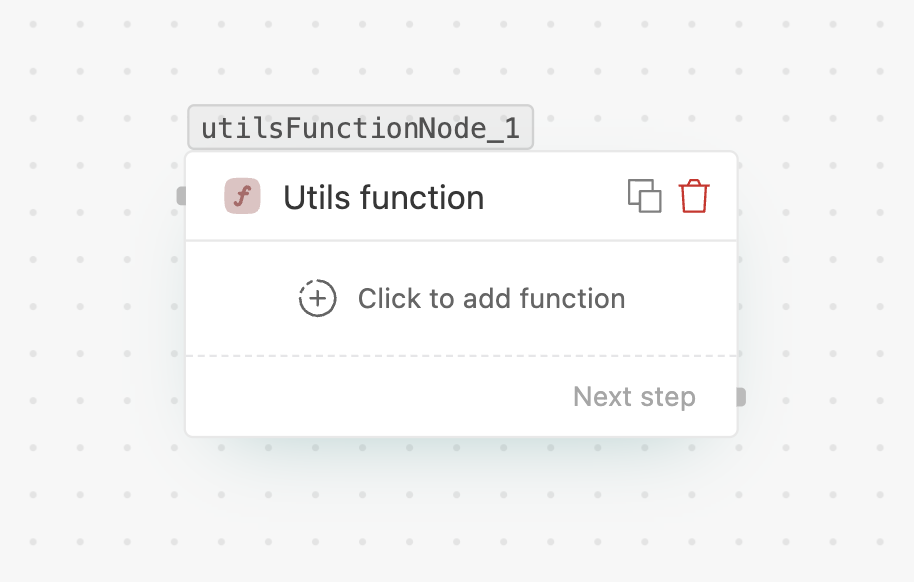

# Utils function

> Run a built-in helper and use its output in later steps.

Choose **Calculate distance** or **Identify Places**, configure inputs, and connect **Next step**.

## Calculate distance

Set **Source latitude**, **Source longitude**, and **Choose a target location** (a configured branch). Coordinates can come from variables, for example a captured customer location.

Select the result through Insert Variable and use a [Condition split](flows/nodes/condition-split.md) to route on proximity.

## Identify Places

Recognize places mentioned in customer text, for example a captured reply.

| Setting | Notes |
| --- | --- |
| **Text** | Required; literal or variable input, up to 2,000 characters. |
| **Entity type** | Country, State, or City in the current picker. |
| **Language** | Any, English, Arabic, Hindi, Urdu, Malayalam, Tamil, Spanish, or Russian. |
| **Country filter** | Optional two-letter ISO code, such as IN or AE, or a variable containing one. Leave blank to search all countries. |

Use **Insert Variable** to select the information you need from the result:

| Output | Meaning |
| --- | --- |
| `entities` | Confirmed matches. |
| `count` | Number of confirmed matches. |
| `suggestions` | Ambiguous or approximate candidates. |

For example, identify a city from the customer's reply, then use its name in a follow-up message. If no place is confirmed or several suggestions are returned, ask the customer to clarify before continuing.
