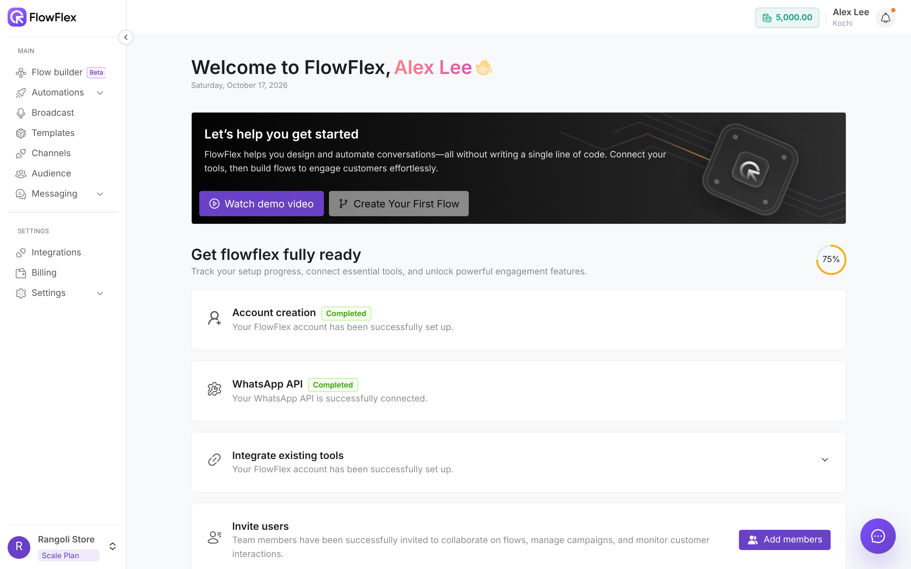

# Find your way around

Find any page in FlowFlex from the sidebar, the top bar or quick search, and switch between branches and organisations.

FlowFlex has a sidebar on the left, a top bar along the top, and the page you are working on in the middle. What you see in the sidebar depends on your role.

When Alex Lee signs in to Rangoli Store, the Home page shows the setup checklist. Alex clicks **Add members** to invite Chris Taylor, then uses **Switch branch** to move from **Kochi** to **Bengaluru** and check that branch's broadcasts.

## Sidebar

The sidebar has two groups, **MAIN** and **SETTINGS**. Click the arrow on its edge to collapse it to icons.

Under **MAIN**:

- **Flow builder** (Beta): build automated WhatsApp flows. See [Flows overview](../flows/overview.md). If you don't see it in the sidebar, contact FlowFlex support.
- **Automations** → **All campaigns**: run and track flows as campaigns. See [Campaigns](../flows/campaigns.md).
- **Automations** → **Saved data**: data your flows have saved.
- **Broadcast**: send one message to many contacts. See [Broadcasts overview](../broadcasts/overview.md).
- **Templates**: create WhatsApp message templates. See [Create a template](../whatsapp/create-template.md).
- **Channels**: connect and manage WhatsApp numbers. See [Connect a WhatsApp channel](../whatsapp/connect-channel.md).
- **Audience**: your contacts, lists and segments. See [Audience](../audience/overview.md).
- **Messaging** → **Conversations**: chat with your contacts. A green badge shows unread messages. See [Conversations](../messaging/conversations.md).
- **Messaging** → **Settings**: messaging settings. See [Messaging settings](../messaging/settings.md).
- **Messaging** → your folders: any custom chat folders you created.

Under **SETTINGS**:

- **Integrations**: connect your own systems. See [Integrations](../integrations/overview.md).
- **Billing**: your billing overview and wallet. See [Billing and wallet](../account/billing-and-wallet.md).
- **Settings** → **Account**: your own profile.
- **Settings** → **Plans**: compare and choose plans. See [Plans and add-ons](../account/plans-and-add-ons.md).
- **Settings** → **Teams**: invite people and manage teams. See [Teams](../account/teams.md).
- **Settings** → **Branches**: add and manage branches. See [Branches](../account/branches.md).

> [!NOTE]
> You only see the items your role allows. For example, **Broadcast** needs **Broadcast view**. **Billing**, **Plans**, **Teams** and **Branches** need **Full control**. See [Roles and permissions](../account/roles-and-permissions.md).

If your plan is not active, clicking a sidebar item shows **Upgrade Required** with an **Upgrade** button.

## Home page

The Home page greets you with **Welcome to FlowFlex,** and your name, plus today's date. To return to it, click the home icon at the start of the top bar.

Below the greeting, **Let's help you get started** has a **Watch demo video** button.

### Get flowflex fully ready

This checklist tracks your setup. The ring on the right shows how much is done.

- **Account creation:** shows **Completed** once your account exists.
- **WhatsApp API:** shows **Completed** once a channel is connected. Until then, **Connect number** starts the Meta signup. See [Connect a WhatsApp channel](../whatsapp/connect-channel.md).
- **Integrate existing tools:** counts once you connect an integration. Click it to expand; **Contact Support** opens WhatsApp support. See [Integrations](../integrations/overview.md).
- **Invite users:** done once you invite a team member. **Add members** opens the invite page. See [Teams](../account/teams.md).

Further down, **Learn the platform** links to video tutorials. **Talk to expert** opens WhatsApp to book a session with a product expert.

## Top bar

The top bar shows where you are, then your wallet balance, your name and the notifications bell on the right.

### Wallet balance

The chip with a coin icon shows your wallet balance. Hover over it to see the full balance and the time of the last activity. Click it to open your wallet. See [Billing and wallet](../account/billing-and-wallet.md).

Recent usage can take a little while to appear in your balance.

### Your name and branch

Your name shows above the current branch, for example **Alex** above **Kochi**. Click it to open the profile drawer, which has:

- **Switch branch:** opens **My Branches**. Pick a branch to work in, or click **Manage** to edit branches.
- **Account settings:** opens your account settings.
- **Invite a user:** opens the invite page. See [Teams](../account/teams.md).
- **Video tutorials:** opens FlowFlex's YouTube channel.
- **App updates:** shows what is new in FlowFlex. A **New** badge marks unread updates.
- **Contact support:** opens WhatsApp support.
- **Sign out:** signs you out and returns you to the sign-in page.

### Notifications

The bell opens **Notifications**. An orange dot means you have unread notifications. Click **Mark all as read** to clear them. With no notifications, the drawer shows **No notification yet**.

You get a notification when longer tasks finish, for example:

- Audience imports and exports, and bulk actions on lists, segments and templates.
- WhatsApp template status updates and template deletions.
- Broadcast metrics exports.
- Wallet recharges and credits.
- Subscription charges, cancellations and mandate reminders.
- Invoice downloads.
- Team invitations sent and accepted.
- Flow installations.

## Quick search

Press **Ctrl+S** anywhere in the app to open quick search. Type part of a page name, then pick it to jump there.

You can jump to Home, Flows, Automation, Broadcast, Audience, Conversations, Chat Settings, Integrations, Account, Billing, Teams, Branches, Templates and Channels. Quick search leaves out pages your role cannot open, and the page you are already on.

## Organisation switcher

The bottom of the sidebar shows your organisation's name and plan, for example **Rangoli Store** and its plan. Without a plan it shows **No Active Plan**. Click it to open the switcher.

- Under **ORGANISATIONS**, click another organisation to switch to it.
- Click **+** to create a new organisation. See [Sign up and sign in](sign-up-and-sign-in.md#create-your-organisation).
- **Account Settings**, **Invite user** and **Sign Out** work like the profile drawer.

To manage your organisation's details, see [Organisation](../account/organisation.md).

## Banners

A banner at the top of the page warns you about your plan, with a button to fix the issue.

| Banner says | Button |
| --- | --- |
| **Your trial period ends in N days.** | **Upgrade Plan** |
| **Your trial has expired.** or **Your plan has ended.** | **Upgrade Plan** |
| **Your subscription will end on** a date | **Upgrade Plan** |
| **Your subscription has been cancelled.** | **Upgrade Plan** |
| **Your account has been suspended due to a payment failure.** | **Upgrade Plan** |
| A renewal payment is pending | **Manage Billing** |
| **Your new plan starts on** a date. **Authorize the mandate before then to keep service active.** | **Authorize now** |

**Upgrade Plan** opens **Plans**. See [Plans and add-ons](../account/plans-and-add-ons.md) and [Billing and wallet](../account/billing-and-wallet.md).

FlowFlex may also show an announcement bar above the top bar. Click **Click here for more details.** to read more.

## WhatsApp support button

The round purple chat button over each page opens a WhatsApp chat with FlowFlex support. The message is pre-filled with your organisation, branch and current page, so support can help faster.

The button is hidden on the Conversations pages. There, use **Contact support** in the profile drawer.

## See also

- [Set up your account](../getting-started.md)
- [Roles and permissions](../account/roles-and-permissions.md)
- [Branches](../account/branches.md)
