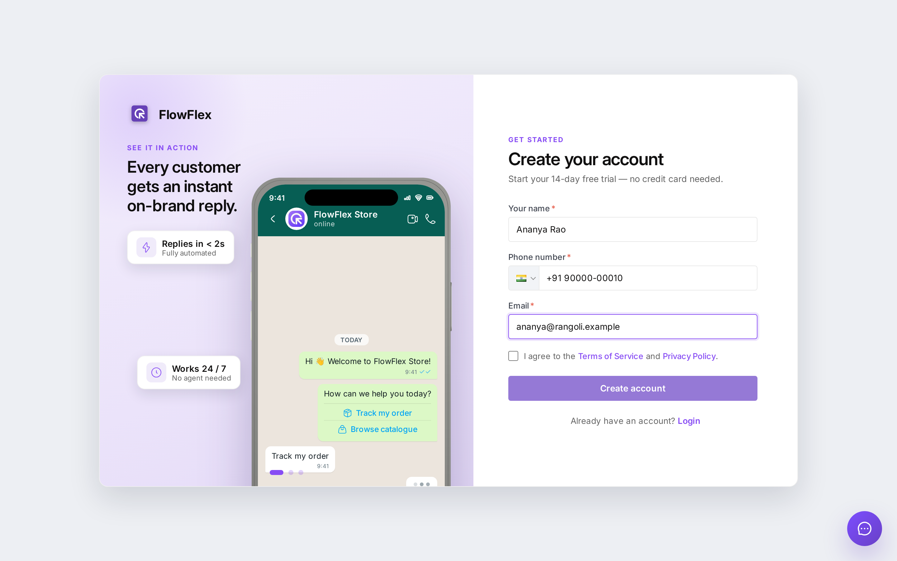
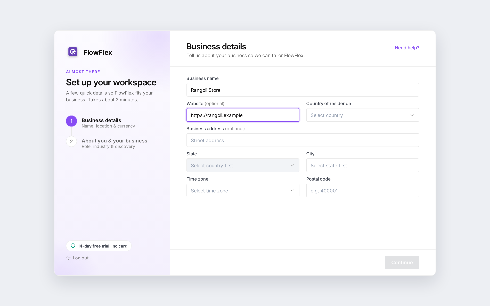

# Sign up and sign in

Create your FlowFlex account, set up your organisation, and sign in to the right workspace.

You do all of this in the FlowFlex login app, a separate page from the main app. The first screen says **Welcome to FlowFlex**. Click **Get started** to create an account, or **Sign in to existing account** if you already have one.

Alex Lee signs up with `alex@rangoli.example`, verifies the account by WhatsApp, and creates the **Rangoli Store** organisation. Later, when Chris Taylor accepts an invite, Chris signs in and goes straight into Rangoli Store.

## Create your account

New accounts can start with a free trial. A banner at the top of the app shows how many days are left.

1. On **Create your account**, fill in the fields below.
2. Tick the box to agree to the **Terms of Service** and **Privacy Policy**. **Create account** stays disabled until you do.
3. Click **Create account**. FlowFlex asks how to send your verification code.

| Field | Required | Notes |
| --- | --- | --- |
| **Your name** | Yes | Your full name, for example `Alex Lee`. |
| **Phone number** | Yes | Pick the country code; it defaults to India (+91). Must be a valid number. |
| **Email** | Yes | Your work email, for example `alex@rangoli.example`. |

If the email is already registered, you see **An account with this email already exists.** Click **Log in instead**.

### Verify your account

1. In **Where should we send your code?**, choose **WhatsApp** (sent to your phone number) or **Email** (sent to your email). **Email** is selected by default.
2. Click **Send verification code**.
3. On **Enter verification code**, type the 6-digit code. You can paste it into the first box.
4. Click **Verify & continue**. FlowFlex asks you to set a password.

Didn't get the code? Click **Resend**. It becomes available after 60 seconds. To fix a wrong number or email, click **Change**.

### Set your password

1. On **Set your password**, type the password in **Enter password**.
2. Type it again in **Re-enter password**. If the two differ, you see **Passwords don't match**.
3. Click **Create account**. FlowFlex takes you to create your organisation.

The password must have:

- **Minimum 8 characters**
- **At least one lower case** letter
- **At least one upper case** letter
- **At least one number**

Each rule is ticked off as you type.

## Create your organisation

An organisation is your business workspace in FlowFlex. Setup has two steps. A **Need help?** button at the top opens WhatsApp support.

### Step 1: Business details

1. Fill in the fields below. Pick the **State** before the **City**.
2. Click **Continue**.

| Field | Required |
| --- | --- |
| **Business name** | Yes |
| **Website** | No |
| **Country of residence** | Yes |
| **Business address** | No |
| **State** | Yes |
| **City** | Yes |
| **Time zone** | Yes |
| **Postal code** | Yes |

Your currency is set from the country you pick.

### Step 2: About you & your business

All fields on this step are optional.

- **Choose your role:** Founder, Developer / PM, Marketer, Sales / BizDev, Customer Support, or Other.
- **How did you discover FlowFlex?:** Instagram, LinkedIn, Google Search, YouTube, and more.
- **Choose your industry:** Education, E-commerce, Travel Agency, Logistics, Health Industry, Marketing Agency, or Other.
- **Your industry:** appears when you choose **Other** as the industry, so you can type your own.

Click **Finish setup**. FlowFlex creates the organisation and opens the app. To change something on step 1, click **Back**.

### If setup is interrupted

Sometimes setup takes longer, or the connection drops. The button then changes to **Continue setup**.

- **Setup is still in progress. Select Continue setup to resume.** Wait a moment, then click **Continue setup**.
- **Setup could not finish. Select Continue setup to retry.** Click **Continue setup** to try again with the same details.

If you come back later, you may see **Continue your workspace setup**. Click **Continue** followed by your organisation's name, for example **Continue Rangoli Store**.

## Sign in

1. On **Sign in to your account**, enter your **Email** and **Password**.
2. Leave **Remember for 30 days** ticked to stay signed in for 30 days. On a shared computer, untick it; you then stay signed in for 1 day.
3. Click **Sign in**.

If your email was never verified, FlowFlex sends you to **Enter verification code** first. If your account has no password yet, for example after an invite, FlowFlex sends a code so you can set one.

### Choose your organisation

What you see after signing in depends on how many organisations you belong to:

- **None:** you see **No organisations found! Please create one** and go to organisation setup.
- **One:** FlowFlex opens it straight away.
- **More than one:** pick one on **Choose Your Organisation** and click **Continue**.

To create another organisation from this screen, click **Add an organisation**. Inside the app you can switch organisations at any time. See [Find your way around](find-your-way-around.md#organisation-switcher).

## Reset a forgotten password

1. On the sign-in screen, type your **Email**. If the box is empty, you see **Please enter email address**.
2. Click **Forgot password?**. FlowFlex emails you a 6-digit code.
3. Enter the code and click **Verify & continue**.
4. Set a new password, following the same rules as when you signed up.
5. Click **Change password**, then sign in with the new password.

## See also

- [Find your way around](find-your-way-around.md)
- [Set up your account](../getting-started.md)
- [Connect a WhatsApp channel](../whatsapp/connect-channel.md)
