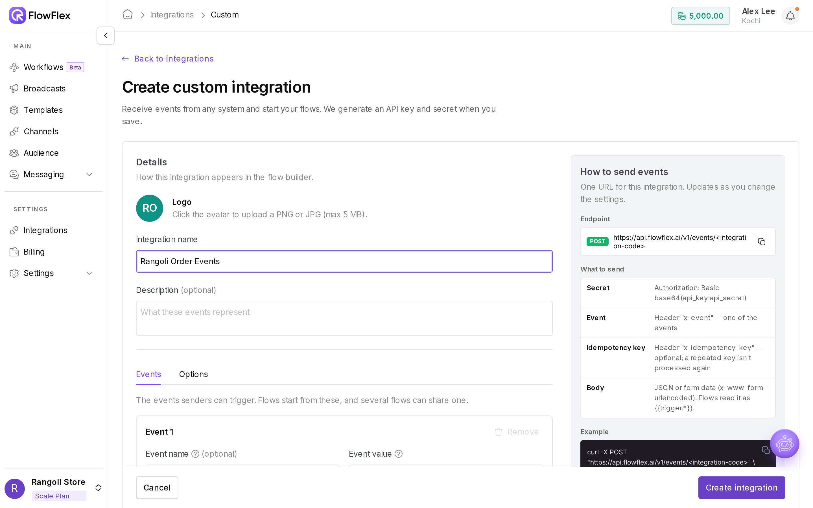
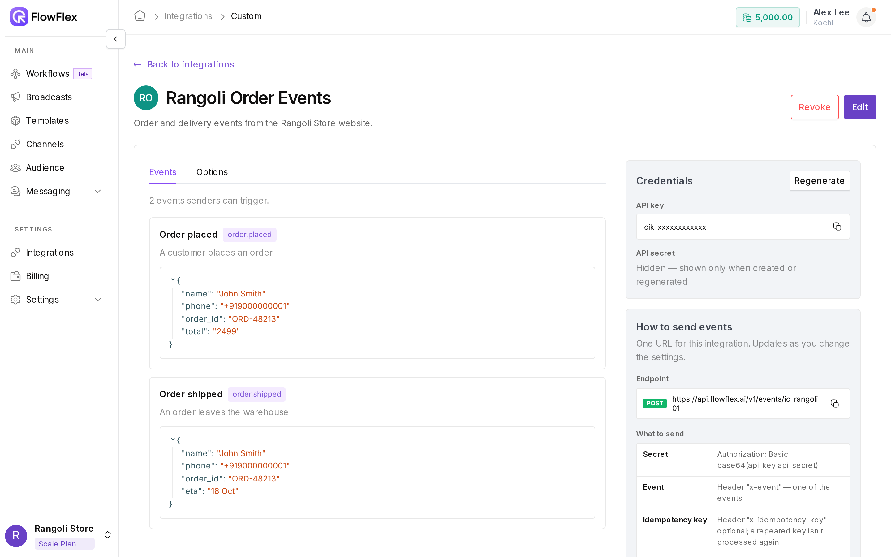

# Set up a custom integration

A custom integration is a named set of events with its own webhook URL, API key and secret. Your system sends an event to the URL, and every flow subscribed to that event runs with the event's data. Use it for systems FlowFlex has no ready-made integration for. For the code side, see the [Developer quick start](../developers/quick-start.md).

Rangoli Store creates an integration called `Rangoli Order Events` with an `order.placed` event. When John Smith places order `RS-1042` on the website, the website sends `order.placed` with John's name, phone number, order number and total. A flow uses those values to send John a WhatsApp confirmation.

## Create a custom integration

1. Go to **Integrations** and click **New** on the **Custom integrations** card. The **Create custom integration** page opens, with the **API / Webhook instructions** on the right.
2. Fill in the [details](custom-integration.md#details).
3. Add at least one [event](custom-integration.md#events).
4. Click **Create integration**. FlowFlex shows your webhook URL and credentials. See [Your integration is live](custom-integration.md#your-integration-is-live).

### Details

Enter an **Integration name**, such as `Rangoli Order Events`. This is the only required detail.

Add a **Description** if you like, a short note on what these events represent. It shows on the integration's card.

To add a logo, click the avatar next to the title and upload a JPG or PNG smaller than 5 MB. If you skip the icon, FlowFlex shows initials on a coloured circle, from the first letters of the first two words: "Rangoli Order Events" shows **RO**.

### Events

Events are the things your system tells FlowFlex about, and flows subscribe to them by name. Add at least one event, or you see **Add at least one event**.

The form starts with one empty event. Click **+ Add event** for more, or **Remove event** to delete one.

<figure><figcaption><p>Adding events to a custom integration</p></figcaption></figure>

| Field                | Required | Rules                                                                                                      |
| -------------------- | -------- | ---------------------------------------------------------------------------------------------------------- |
| **Event name**       | No       | A readable title, for example `Order placed`. If empty, FlowFlex uses the event value.                     |
| **Event value**      | Yes      | The identifier your system sends in the `x-event` header, for example `order.placed`. See the rules below. |
| **Description**      | No       | What this event represents.                                                                                |
| **Expected payload** | No       | A sample of the JSON data this event carries.                                                              |

An **Event value**:

* Has 1 to 64 characters.
* Uses letters, numbers, dot (`.`), underscore (`_`) or hyphen (`-`).
* Starts and ends with a letter or number. `order.placed` is valid; `.order` and `order-` are not.
* Is unique within the integration. `Order.Placed` and `order.placed` count as the same value.

### Expected payload

**Expected payload** describes the data your system sends with the event. Switch between two views:

* **Code:** type or paste raw JSON. Invalid JSON shows **Invalid JSON** under the box.
* **Tree:** edit the same JSON as a tree of keys and values.

The sample powers the `{{trigger.*}}` hints in the flow builder. Rangoli Store uses this sample for `order.placed`:

```json
{
  "customer": { "name": "John Smith", "phone": "919000000001" },
  "order_id": "RS-1042",
  "total": 1499
}
```

It gives the flow builder `{{trigger.customer.name}}`, `{{trigger.customer.phone}}`, `{{trigger.order_id}}` and `{{trigger.total}}`. See [Choose the trigger](../flows/triggers-and-variables.md).

> \[!TIP] Use realistic sample values. The sample only describes the fields; each real event brings its own values.

## Your integration is live

After you click **Create integration**, FlowFlex shows **Your integration is live**.

<figure><figcaption><p>A live custom integration with its webhook details</p></figcaption></figure>

The **Credentials** card shows three values:

| Value           | Looks like                                            | Use                                                                    |
| --------------- | ----------------------------------------------------- | ---------------------------------------------------------------------- |
| **Webhook URL** | `POST https://<your-flowflex-host>/v1/events/ic_xxxx` | Where your system sends events. The last part is the integration code. |
| **API Key**     | `cik_xxxx`                                            | The username for HTTP Basic Auth.                                      |
| **API Secret**  | `cisk_xxxx`                                           | The password for HTTP Basic Auth. Tagged **Shown once**.               |

The secret is masked. Click **Reveal** to see it, and the copy icon to copy it.

> \[!WARNING] The API secret is shown only once. Copy it or download the .env now, because it can't be retrieved later. To get a new one, [regenerate the credentials](custom-integration.md#regenerate-credentials).

Click **Download .env** to save a file with all three values:

```bash
FLOWFLEX_API_KEY=cik_xxxx
FLOWFLEX_API_SECRET=cisk_xxxx
FLOWFLEX_WEBHOOK_URL=https://<your-flowflex-host>/v1/events/ic_xxxx
```

Click **Go to integrations** when you're done. Your new integration now has its own card.

## Send events

The **API / Webhook instructions** panel, under **How to send events**, sums up the request:

| Part                | Value                                                                 |
| ------------------- | --------------------------------------------------------------------- |
| Method and URL      | `POST` to the integration's **Webhook URL**, over HTTPS only          |
| `Authorization`     | HTTP Basic Auth: API key as username, API secret as password          |
| `x-event`           | One of this integration's event values, for example `order.placed`    |
| `content-type`      | `application/json`                                                    |
| `x-idempotency-key` | Optional. A unique ID that stops a retried request from running twice |
| Body                | The event data, matching the expected payload                         |

One integration has one webhook URL, and the `x-event` header says which event it is. Every flow subscribed to that event runs.

To send a file with an event, such as John Smith's invoice PDF, open **Attaching files to events** in the same panel. It takes three calls and accepts files up to 25 MB.

For the full developer guides, see the [Developer quick start](../developers/quick-start.md), [Send events](../api/events.md), [Upload assets](../api/assets.md) and [Install and use the SDK](../sdk/overview.md).

## Use the integration in a flow

In the flow builder, choose the trigger source **Custom**, then your integration, then the event. Only active integrations appear in the list. See [Choose the trigger](../flows/triggers-and-variables.md).

## Manage an integration

On the **Integrations** page, click **Manage** on the integration's card. The page shows:

* The name, description and icon. Click the icon to upload a new one.
* **Events**, with each event value, name, description and expected payload.
* **API / Webhook instructions** for this integration.
* **Credentials**: the **API Key**, and **API Secret** marked **Hidden — shown only once at creation**.

### Edit

1. Click **Edit**. The name, description and events become editable.
2. Make your changes.
3. Click **Save changes** to keep them, or **Cancel** to discard them.

The API key, secret and webhook URL don't change when you edit.

### Regenerate credentials

Regenerate whenever the secret may have leaked.

1. Click **Regenerate** in the **Credentials** panel.
2. Confirm **Regenerate credentials?**. FlowFlex creates a new API key and secret, and the old pair stops working immediately. The webhook URL stays the same.
3. Copy the new secret with **Reveal** and the copy icon. It's shown once, so update every system that sends events before you close the page.

### Revoke an integration

1. Click **Revoke**.
2. Confirm **Revoke this integration?**.

Systems can no longer start flows with this integration's key. The card shows a **Revoked** tag, and the integration leaves the flow trigger list. **Edit**, **Revoke** and **Regenerate** disappear, and **Delete** appears.

You can't revoke an integration that is still a flow's trigger. FlowFlex shows **Can't revoke — integration in use** and lists those flows. Change their trigger first, then revoke.

### Delete an integration

You can delete only a revoked integration.

1. Click **Delete**.
2. Confirm **Delete this integration?**.

The integration is removed from your integrations list, and this can't be undone. Deletion is also blocked while any flow uses the integration (**Can't delete — integration in use**).

## Permissions

* **Integration view:** see integrations and open **Manage**.
* **Integration create:** create an integration.
* **Integration edit:** edit, change the icon, and regenerate credentials.
* **Integration delete:** revoke and delete.

See [Roles and permissions](../account/roles-and-permissions.md).

## See also

* [Integrations overview](overview.md)
* [Developer quick start](../developers/quick-start.md)
* [Send events](../api/events.md)
* [Choose the trigger](../flows/triggers-and-variables.md)
