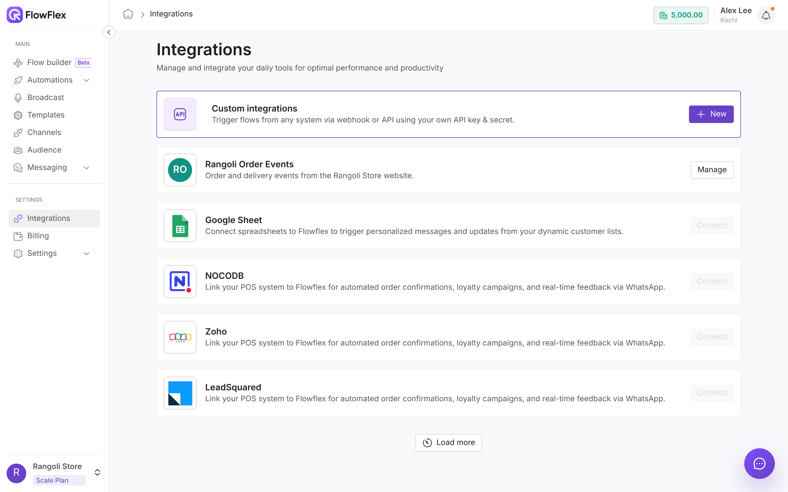

# Integrations overview

An integration links FlowFlex to another system. The system sends FlowFlex an event when something happens, such as an order being placed, and every flow that listens for that event runs. Go to **SETTINGS** → **Integrations** to see what you can connect and manage what you've set up.

Rangoli Store takes orders on its own website. The team creates a custom integration called `Rangoli Order Events` with one event, `order.placed`. When John Smith places order `RS-1042`, the website sends that event to FlowFlex, and a flow sends John a WhatsApp confirmation with the order number and total.

<figure><figcaption>
The Integrations page
</figcaption></figure>

## How it works

1. Create an integration and list the events your system will send.
2. Your developer sends those events to FlowFlex, using the integration's webhook URL and credentials.
3. In the flow builder, pick the integration and event as the flow's trigger.
4. Each time an event arrives, the flow runs with that event's data.

## What you can connect

* **Custom integrations:** start flows from any system, such as your website, order system or CRM, through a webhook or the FlowFlex SDK. Each integration has its own API key and secret. See [Custom integrations](custom-integration.md).
* **Shopify:** to connect your Shopify store, contact FlowFlex support with the **WhatsApp support** button in the app, and the team will set it up with you.

Other cards on the page show a greyed-out **Connect** button. Those integrations aren't available yet.

## Get started

* [Set up a custom integration](custom-integration.md): create the integration, its events and its credentials.
* [Developer quick start](../developers/quick-start.md): send your first event and see a WhatsApp message go out.
* [Install and use the SDK](../sdk/overview.md): send events from JavaScript or Python.

## Your custom integrations

Each custom integration you create gets its own card below the **Custom integrations** card, with its name and description.

* Click **Manage** to see its events, credentials and webhook instructions.
* A **Revoked** tag means the integration no longer accepts events. See [Revoke an integration](custom-integration.md#revoke-an-integration).

## Integrations belong to a branch

Integrations are saved per branch. An integration set up in the Kochi branch doesn't appear in the Bengaluru branch. To work in another branch, switch branch first. See [Branches](../account/branches.md).

## Permissions

You see **Integrations** in the sidebar only if your role includes **Integration view**. The other actions need:

* **Integration create:** create a custom integration.
* **Integration edit:** edit a custom integration or regenerate its credentials.
* **Integration delete:** revoke or delete a custom integration.

To change what a role can do, see [Roles and permissions](../account/roles-and-permissions.md).

> \[!NOTE] If your plan isn't active, clicking a sidebar item shows **Upgrade Required**. Choose a plan to continue. See [Plans and add-ons](../account/plans-and-add-ons.md).

## See also

* [Custom integrations](custom-integration.md)
* [Developer quick start](../developers/quick-start.md)
* [Choose the trigger](../flows/triggers-and-variables.md)
