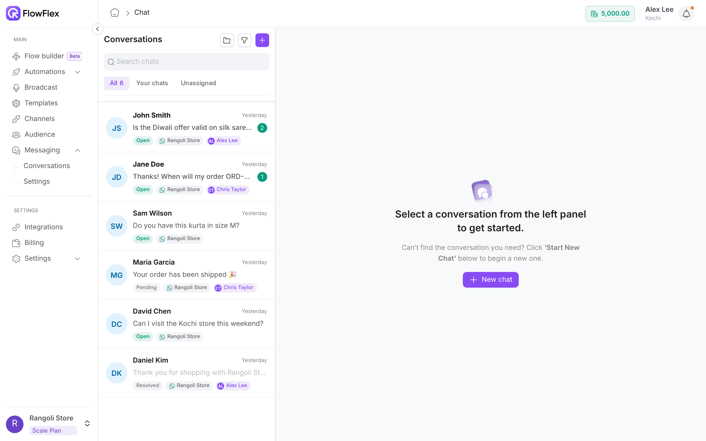
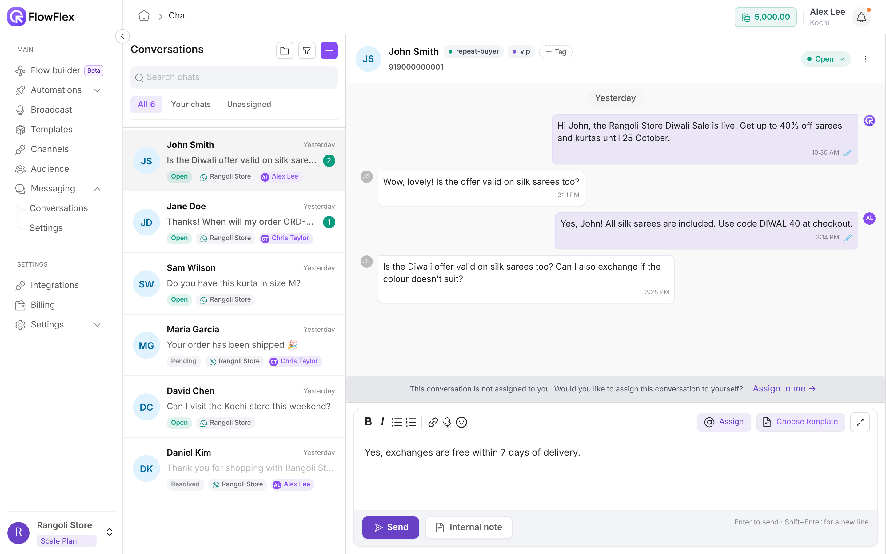

# Conversations

Read, reply to, assign and organise your customers' WhatsApp chats in one shared inbox.

**Messaging** → **Conversations** shows every chat your team can see. The screen has three parts: the conversation list on the left, the open chat in the middle with its header and composer, and the **Customer Details** panel, which opens when you click the contact's name.

On a Monday morning, Chris Taylor, a support agent at Rangoli Store, opens **Unassigned** and finds a question from John Smith about a delayed order. Chris assigns the chat to themselves, replies with the `/hours` quick reply and a tracking update, and marks the chat **Resolved** once John confirms the parcel arrived.

## Tabs and who sees what

The list has three tabs, and the active tab shows its count:

* **All** shows every conversation you are allowed to see. This is the default tab.
* **Your chats** shows conversations assigned to you.
* **Unassigned** shows conversations with no agent assigned.

What you can see depends on your role. With the **Conversation view all** permission for every channel in the branch, **All** and **Unassigned** show the whole team's chats. Without it, you see only conversations assigned to you, or with contacts you own. See [Roles and permissions](../account/roles-and-permissions.md) to change a role.

## Search and filter

**Search chats** finds conversations by contact name or phone number.

To filter the list:

1. Click the filter icon (**Apply filter**). **Filter conversation** opens.
2. Choose any of these:
   * **Channels**: only chats on the selected WhatsApp numbers.
   * **Status**: **Open**, **Pending** or **Resolved**.
   * **Tags**: contacts with any of the selected tags. See [Tags](../audience/tags.md).
   * **Unread only**: only chats with unread messages.
3. Click **Apply**. The filter icon becomes **Reset filters**; click it to clear all filters.

## Act on a chat from the list

Right-click a conversation in the list to:

* **Mark as read** or **Mark as unread**.
* **Mark as resolved**, **Reopen conversation** or **Mark as pending**.
* **Assign agent**, then pick a teammate, such as Chris Taylor.

## Custom folders

A folder is a saved view, such as "Open chats on the support number". Folders are shared with everyone in the branch and appear in the sidebar under **Messaging**. You need the **Conversation reply** permission to manage folders.

To create a folder:

1. Click the folder icon (**Create folder**) next to the conversation title.
2. Fill in the fields below.
3. Click **Create folder**. The folder appears in the sidebar.

| Field           | Rule                                             |
| --------------- | ------------------------------------------------ |
| **Folder Name** | Required. Must be unique in the branch.          |
| **Channels**    | Required. One or more WhatsApp numbers.          |
| **Status**      | Required. **Open**, **Pending** or **Resolved**. |

To change a folder, open it from the sidebar, click the pencil icon (**Edit folder**), make your changes and click **Update folder**.

To delete a folder, open it, click the red bin icon (**Delete folder**) and confirm. Deleting a folder doesn't delete any conversations.

Inside a folder, the tabs and the filter are hidden.

## Start a new chat

You need the **Audience create** permission to start a chat.

1. Click **+** (**New chat**) at the top of the list. When no chat is open, you can also click **New chat** in the middle of the screen.
2. In **Start new chat**, enter a **Name**, such as `Jane Doe`.
3. Enter the **Mobile** number with the country code, such as `+919000000002`.
4. Pick **Send from channel**.
5. Click **Start chat**. The new chat opens.

A new chat has no open 24-hour window, so your first message must be a template. See [The 24-hour window](conversations.md#the-24-hour-window).

## Chat header actions

The header shows the contact's name, tags and number. From it you can:

* **Change status:** click the status pill, such as **Open**. In **Set status**, pick **Open**, **Pending** or **Resolved**. A resolved chat shows **Reopen** instead of **Open**.
* **Add or remove tags:** click **+ Tag**. In **Categorize contact**, tick tags, or type a new name and click **Create "…"**. This needs the **Audience edit** permission.
* **Assign to yourself:** if the chat isn't yours, a banner appears above the composer. Click **Assign to me →**.
* **Assign to someone else:** right-click the chat in the list and choose **Assign agent**, or use **Assigned to** in **Customer Details**.
* **Clear chat:** click **⋮** → **Clear chat** → **Yes**. This removes the messages from FlowFlex only. The customer's WhatsApp isn't affected.

On a phone, **⋮** also holds **Mark as pending** (or **Mark as reopened**) and **Assign to me**.

## Write a message

Type in the composer and press **Enter** to send. Press **Shift+Enter** for a new line.

The composer toolbar has:

* **Bold**, **Italic**, **Bulleted list** and **Numbered list** to format your text.
* **Emoji** to insert an emoji.
* **Attach file** to add one file. See [Attachments](conversations.md#attachments).
* **Record a voice note** to record up to 4 minutes, then click **Send**. Click the bin icon to discard it.
* **Assign** (@) to mention a teammate. See [Mentions and internal notes](conversations.md#mentions-and-internal-notes).
* **Choose template** to open the template drawer.
* **Expand composer** to open a larger editor.

### Attachments

| Limit        | Value                                                                 |
| ------------ | --------------------------------------------------------------------- |
| File types   | JPG, PNG, MP4, MKV, PDF, Word (.doc, .docx), Excel (.xls, .xlsx), CSV |
| Maximum size | 10 MB per file                                                        |

Other file types are rejected with **You can only upload JPG, PNG, MP4, MKV, PDF, Word, Excel, or CSV files!**. Larger files show **File size must be smaller than 10MB!**.

### Reply to a specific message

Hover over a message and click **Reply**. A **Replying to** strip appears above the composer. Click **×** to cancel.

### Quick replies

Type `/` to see your quick replies. Keep typing to narrow the list, such as `/hours`. Press **Enter** or click one to insert its text, then edit it before sending if you need to. See [Quick replies](quick-replies.md) to create them.

## When a message can't be sent

If the chat's WhatsApp channel can't send right now, the **Send** button is disabled and shows a warning icon. Hover over it to see why, with a link to fix it:

* **Channel disconnected:** reconnect the number in **Channels**.
* **Channel authorization failed:** reconnect the number in **Channels**, or contact FlowFlex support.
* **Channel disabled by your plan:** upgrade or add a channel in **Plans**.

If a message can't be sent, it still stays in the chat history, marked as failed. Hover over the red icon next to it to see the reason, for example:

* **Not sent: your wallet balance is negative. Add message credits in Billing to send messages.** This applies to agent replies in Conversations only; flows aren't affected. See [Billing and wallet](../account/billing-and-wallet.md).
* **Not sent: channel authorization failed. Reconnect this WhatsApp channel in Channels, or contact FlowFlex support.**

Once you've fixed the cause, send your reply again.

## Mentions and internal notes

An internal note is visible to your team only. The customer never sees it.

* To add a note, type it and click **Internal note**.
* To edit or delete your note, hover over it and click **Edit note** or **Delete note**.

To hand a chat to a teammate, type `@` or click **Assign**, then pick a name, such as Alex Lee. The button changes to **Save note & assign**. Clicking it saves the note and assigns the chat to Alex Lee.

A message that mentions a teammate is always saved as a note and never sent to the customer. You need the **Conversation assign** permission to mention.

## The 24-hour window

WhatsApp lets you send free-form messages only within 24 hours of the customer's last message. FlowFlex counts from the last incoming message in the chat.

After the window closes:

* The composer shows **WhatsApp requires an approved template to start or restart this conversation. Pick one to message the customer, or add an internal note below.**
* **Send** and voice notes are hidden, so you can only send a template or add an internal note.
* The chat ends with "To restart the conversation, you need to send a template message and wait for customer response".

When the customer replies, the window opens again for 24 hours.

## Send a template in a chat

You need the **Template view** permission to see templates.

1. Click **Choose template**.
2. In **Choose a template**, search with **Search approved templates**. Only Approved templates for this chat's channel appear.
3. Click a template, such as `order_shipped_v1`, to see its **Preview**.
4. Fill in each field under **Dynamic variables**, such as the customer's name. For a location header, fill in **Latitude**, **Longitude**, **Location name** and **Address**.
5. Click **Send to** followed by the contact's number. The template appears in the chat.

If the list is empty, click **Create Template**. See [Create a template](../whatsapp/create-template.md).

> \[!WARNING] If the contact has opted out of WhatsApp marketing, a dot appears on **Choose template**. Hover over it to see **This customer is not subscribed to WhatsApp marketing. Marketing templates will be skipped.** Send a Utility template instead, or ask the customer to reply START. See [Subscription Auto Replies](settings.md#subscription-auto-replies).

## Customer Details

Click the contact's name or avatar in the header to open **Customer Details**. It has:

* **Profile:** edit the name and email with the pencil icon. The phone number is read-only.
* **Tags:** click the pencil to add or remove tags.
* **Channel ID** and **Channel Name:** the WhatsApp number this chat uses.
* **Assigned to:** pick the agent who owns the chat.
* **Events history:** status changes, assignments and other events on this chat.

If **Mask prospect phone numbers** is on, you may see numbers like `+91 XXXXXX0001`. See [Conversation privacy](settings.md#conversation-privacy).

## Read-only conversations

If the chat's WhatsApp channel was removed or is no longer available, the list shows **Channel unavailable** on the chat and the chat becomes read-only. You can still read the history and add internal notes, but you can't send messages or templates.

## See also

* [Messaging settings](settings.md): business hours, assignment and automatic replies.
* [Quick replies](quick-replies.md): save answers your team sends often.
* [Connect a channel](../whatsapp/connect-channel.md): add or reconnect a WhatsApp number.
