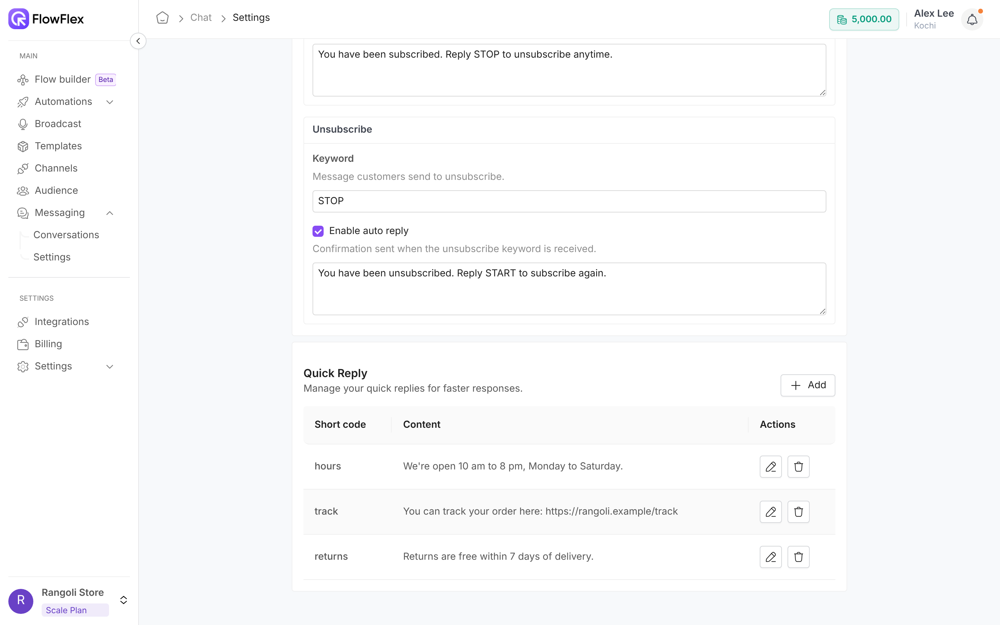

# Quick replies

Save answers you send often, and insert them into any chat by typing `/` and a short code.

A quick reply is a piece of saved text, such as your opening hours or return policy. Quick replies are shared by everyone in your organisation, so the whole team answers common questions the same way.

Customers often ask Rangoli Store when it's open. Alex Lee saves a quick reply with the short code `/hours` and the content "Rangoli Store is open Monday to Saturday, 10 am to 8 pm." When Sam Wilson asks the same question, Chris Taylor types `/hou`, presses **Enter**, and sends the answer in seconds.

## Create a quick reply

You need the **Messaging settings edit** permission to add, edit or delete quick replies.

1. Go to **Messaging** → **Settings**.
2. Scroll to **Quick Reply** and click **Add**. **Add Quick Reply** opens.
3. Fill in the fields below, such as `hours` and Rangoli Store's opening hours.
4. Click **Add**. The quick reply appears in the **Quick Reply** table.

| Field          | Rule                                                                                                                                        |
| -------------- | ------------------------------------------------------------------------------------------------------------------------------------------- |
| **Short code** | Required. FlowFlex adds `/` at the start, turns spaces into `_`, and makes it lowercase. For example, `Store Hours` becomes `/store_hours`. |
| **Content**    | Required. The text that is inserted into the chat.                                                                                          |

## Edit or delete a quick reply

In the **Quick Reply** table:

* Click the pencil icon to open **Edit Quick Reply**. Change the fields and click **Update**.
* Click the bin icon, then **Yes**, to delete it.

## Use a quick reply in a chat

1. Open a conversation in **Messaging** → **Conversations**.
2. In the composer, type `/`. The list of quick replies appears.
3. Keep typing to narrow it, such as `/hou`.
4. Press **Enter**, or click the quick reply. Its content replaces the short code.
5. Edit the text if needed, then send.

If nothing matches, the list shows **No quick replies found**.

> \[!TIP] Quick replies are free-form text, so you can send them only within the 24-hour window. After that, use a template. See [The 24-hour window](conversations.md#the-24-hour-window).

## See also

* [Conversations](conversations.md): reply to and assign customer chats.
* [Messaging settings](settings.md): greeting, away and subscription messages.
