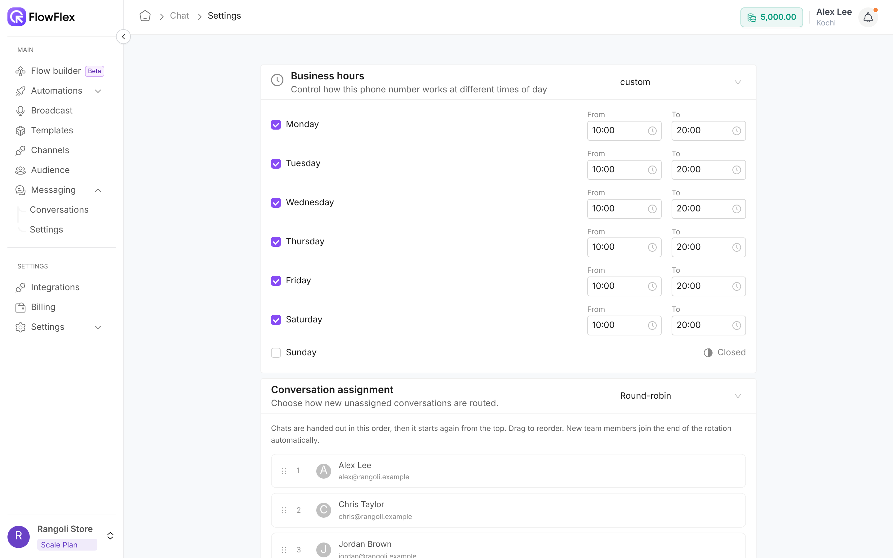
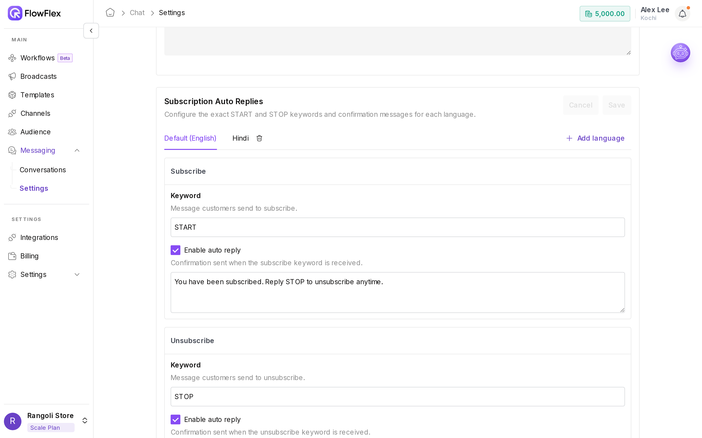

# Messaging settings

Go to **Messaging** → **Settings** to open the **Conversation settings** page. Its cards cover business hours, conversation assignment, privacy, greeting and away messages, subscription keywords and quick replies. Most changes save automatically. These settings apply to your whole organisation; only the agent rotation order is set per branch.

Rangoli Store's Kochi team works 10:00 to 20:00, Monday to Saturday. Alex Lee sets those business hours, switches assignment to **Round-robin** so new chats are shared between Chris Taylor and the rest of the team, and turns on an Away Message. When Maria Garcia messages at 22:00, the Away Message tells Maria when the team will reply, and the chat is waiting for an agent in the morning.

## Who can use this page

| Permission                  | Access                                                                                         |
| --------------------------- | ---------------------------------------------------------------------------------------------- |
| **Messaging settings view** | See the page, read-only.                                                                       |
| **Messaging settings edit** | Change the settings.                                                                           |
| Neither                     | The page shows **Access denied** with "You do not have permission to view messaging settings." |

See [Roles and permissions](../account/roles-and-permissions.md).

## Set business hours

Business hours decide when the **Away Message** is sent. Set them in your business's local time.

1. Pick a mode from the menu next to the **Business hours** title:
   * **Open for selected hours:** each ticked day opens between **From** and **To**, in 24-hour time. The default is 09:00 to 17:30.
   * **Always open:** each ticked day is **Open 24 hours**.
2. Tick the days you're open. An unticked day shows **Closed**.
3. For **Open for selected hours**, set **From** and **To** for each day, such as 10:00 to 20:00.

## Conversation assignment

This decides who gets a new conversation that has no agent. Pick an option from the menu next to the title:

* **Not assigned:** new chats land in **Unassigned**, and agents pick them up.
* **Round-robin:** new chats are handed to agents in turn.

FlowFlex keeps an existing assignee first. If the contact already has an owner in Audience, the chat goes to that person. Round-robin is used only when neither applies.

### Agent rotation order

With **Round-robin**, the agents in the branch are listed in order. Drag a name to reorder; FlowFlex saves it and shows **Rotation order saved**.

New team members join the end of the list automatically, and people who leave are skipped. If nobody has access to the branch, you see **No agents have access to this branch yet**. See [Teams](../account/teams.md).

## Conversation privacy

Turn on **Mask prospect phone numbers** to hide most of each customer's number in Conversations, for example `+91 XXXXXX0001`.

* Only users with **Full control** see this card.
* Users with **Conversation view all** still see full numbers.
* Masking applies to the chat screens only.

## Greeting Message

The greeting is sent automatically when a customer starts a new conversation.

1. Tick **Enable**.
2. Type the message, such as "Hi! Thanks for messaging Rangoli Store. An agent will reply shortly." The text saves as you type.

## Away Message

The away message is sent instead of the greeting when a new conversation starts outside business hours.

1. Tick **Enable**.
2. Type the message, such as "Rangoli Store is closed right now. We reply from 10:00, Monday to Saturday."

### When each message is sent

A conversation counts as new when it is the customer's first message, or the chat had no activity for 24 hours.

| Situation                                                      | Message sent         |
| -------------------------------------------------------------- | -------------------- |
| New conversation, outside business hours, Away Message enabled | **Away Message**     |
| New conversation, any other time, Greeting Message enabled     | **Greeting Message** |
| Ongoing conversation (activity in the last 24 hours)           | None                 |
| The contact is currently in a running flow                     | None                 |

Only one of the two is sent. If the Away Message is off, the greeting is sent outside hours too.

## Subscription Auto Replies

Customers send a keyword to subscribe to or unsubscribe from your marketing messages. The **Subscription Auto Replies** card sets those keywords and the confirmation replies, per language.

Each language has a **Subscribe** card and an **Unsubscribe** card, each with a **Keyword** and an **Enable auto reply** option. **Default (English)** is always there and can't be removed. Its defaults are:

|                 | Keyword | Auto reply                                                   |
| --------------- | ------- | ------------------------------------------------------------ |
| **Subscribe**   | `START` | You have been subscribed. Reply STOP to unsubscribe anytime. |
| **Unsubscribe** | `STOP`  | You have been unsubscribed. Reply START to subscribe again.  |

Each **Keyword** is required, can be up to 100 characters, and must be unique across all languages. When **Enable auto reply** is ticked, the confirmation text is required. Untick it to change the contact's consent without replying.

To add a language:

1. Click **Add language**.
2. Pick a language and click **Add**. A new tab appears.
3. Fill in both keywords and replies.
4. Click **Save**. **Cancel** discards unsaved changes.

To remove a language, click the bin icon on its tab.

The keyword must be the whole message or a button the customer taps. Matching ignores upper and lower case, so `stop` and `Stop` both work. A keyword message, such as STOP or START, never starts an automation campaign.

### Link with the Marketing opt-out button

The **Marketing opt-out** button on a template uses your **Unsubscribe** keyword as its text. FlowFlex picks the keyword for the template's language, or falls back to Default (English). Tapping it unsubscribes the contact, just like typing the keyword. See [Create a template](../whatsapp/create-template.md#buttons).

Unsubscribed contacts are skipped for Marketing templates in broadcasts and chats. See [Broadcast guidelines](../broadcasts/broadcast-guidelines.md).

## Quick Reply

The last card manages saved replies for agents. See [Quick replies](quick-replies.md).

## See also

* [Conversations](conversations.md): reply to and assign customer chats.
* [Quick replies](quick-replies.md): save answers your team sends often.
* [Roles and permissions](../account/roles-and-permissions.md): control who can change these settings.
