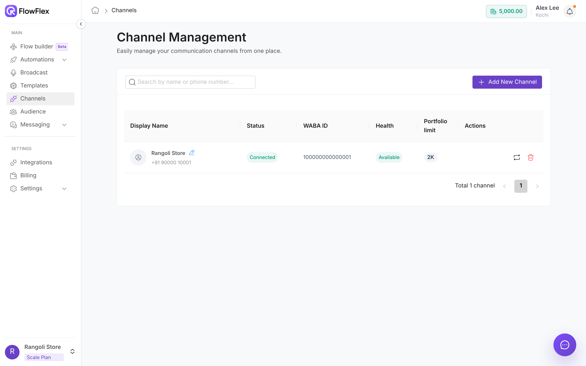

# Connect a WhatsApp channel

Connect your business's WhatsApp number to FlowFlex so you can send templates, broadcasts and replies from it.

A channel is one WhatsApp number. You connect it through Meta's Embedded Signup popup, which links the number's Business portfolio and WhatsApp Business Account (WABA) to FlowFlex. You can't type in a WABA ID or phone number ID by hand.

FlowFlex connects in **coexistence** mode, so the business can keep using the WhatsApp Business app on the phone. The app's contacts and chat history are synced into FlowFlex.

Rangoli Store already answers customers from the WhatsApp Business app at its Kochi counter. Alex Lee, the Admin, connects that same number to FlowFlex. The counter staff keep chatting from the phone, and the marketing team can now send the Diwali sale broadcast from FlowFlex.

## Before you start

Have these ready:

* **Business details:** the business's legal name and address.
* **Display name:** the name shown on the WhatsApp profile. It must match the business's brand, or Meta declines it.
* **Phone number:** for a new setup, a number not already registered on WhatsApp. For coexistence, the number already on the WhatsApp Business app.
* **Meta access:** access to the business's Meta (Facebook) Business portfolio.

## Connect the number

1. Go to **Channels** → **Add New Channel**. During onboarding, the Home page shows **Continue with Facebook** instead.
2. If you see **Channel limit reached**, your plan has no free channel. Add an extra channel under **Settings** → **Plans** → **Configure Add-ons**, or upgrade your plan. See [Plans and add-ons](../account/plans-and-add-ons.md).
3. In the Meta popup, pick or create the Business portfolio and the WhatsApp Business Account. Add the number and verify it with the code Meta sends.
4. Wait for **WhatsApp number configured successfully**. If you see **Finalizing channel setup**, registration is still running. Click **Refresh status** after a minute.
5. Open the channel and fill in the **Business Profile**: description (up to 150 characters), address, email and website. Customers see these details on your WhatsApp profile.

## Check the channel

The Channels table shows the state of each number:

| Column          | Values                                 | Meaning                                                                                 |
| --------------- | -------------------------------------- | --------------------------------------------------------------------------------------- |
| Status          | Connected / Pending / Disconnected     | Only **Connected** channels can create templates or send broadcasts.                    |
| Health          | Available / Limited / Blocked          | Limited or Blocked means Meta is restricting the number. Fix this before you broadcast. |
| Portfolio limit | 250 / 1K / 2K / 10K / 100K / Unlimited | Unique recipients per rolling 24 hours, shared across the whole Business portfolio.     |
| Display Name    | Editable                               | Change it with **Update Display Name**. Meta reviews every change.                      |

Open a channel to see its Quality Rating, Business Verification Status, Display Name Status, Official Business Account (blue tick) and Throughput Level.

## Grow the portfolio limit

A new Business portfolio starts at 250 unique recipients per 24 hours. It moves to 2,000 after **Business Verification**, or after delivering 2,000 messages to unique users in 30 days with high-quality templates ([Meta rule](https://developers.facebook.com/documentation/business-messaging/whatsapp/messaging-limits)).

After that, Meta raises the limit one level at a time (10K, 100K, Unlimited), within 6 hours, when quality stays high and you used at least half the limit in the last 7 days. For how to warm up a new number, see [Grow a new number gently](../broadcasts/broadcast-guidelines.md#grow-a-new-number-gently).

## Common problems

| Message                        | Cause                                                                | Fix                                                                        |
| ------------------------------ | -------------------------------------------------------------------- | -------------------------------------------------------------------------- |
| Channel disconnected           | The WhatsApp Business app was uninstalled or logged out on the phone | Reconnect from the channel page.                                           |
| Display name declined          | The name doesn't match the brand                                     | Rename it to match the website or signage, then resubmit.                  |
| **Channel needs reconnecting** | The number is connected at Meta but FlowFlex can't send for it yet   | Reconnect the channel from the channel page, or click **Contact Support**. |

## See also

* [Create a template](create-template.md)
* [Broadcast guidelines](../broadcasts/broadcast-guidelines.md)
* [Plans and add-ons](../account/plans-and-add-ons.md)
