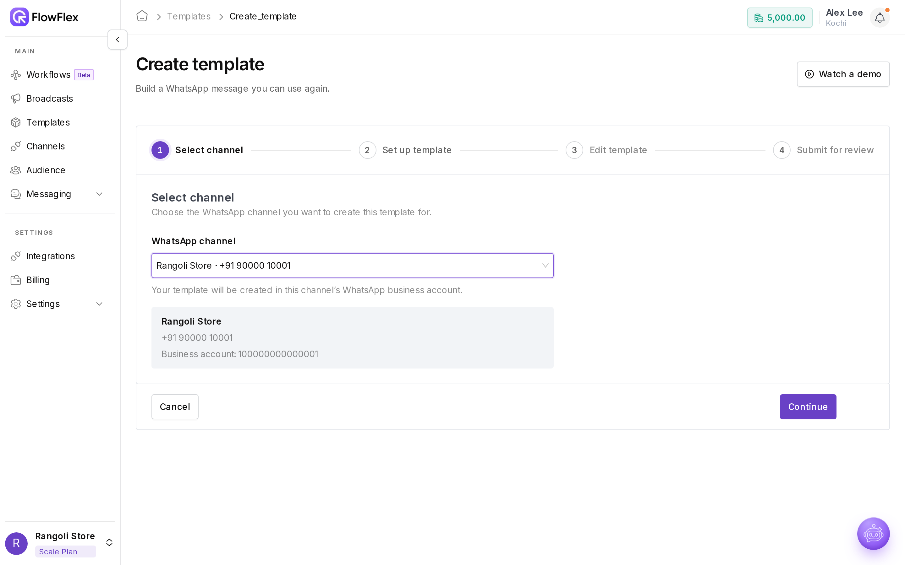
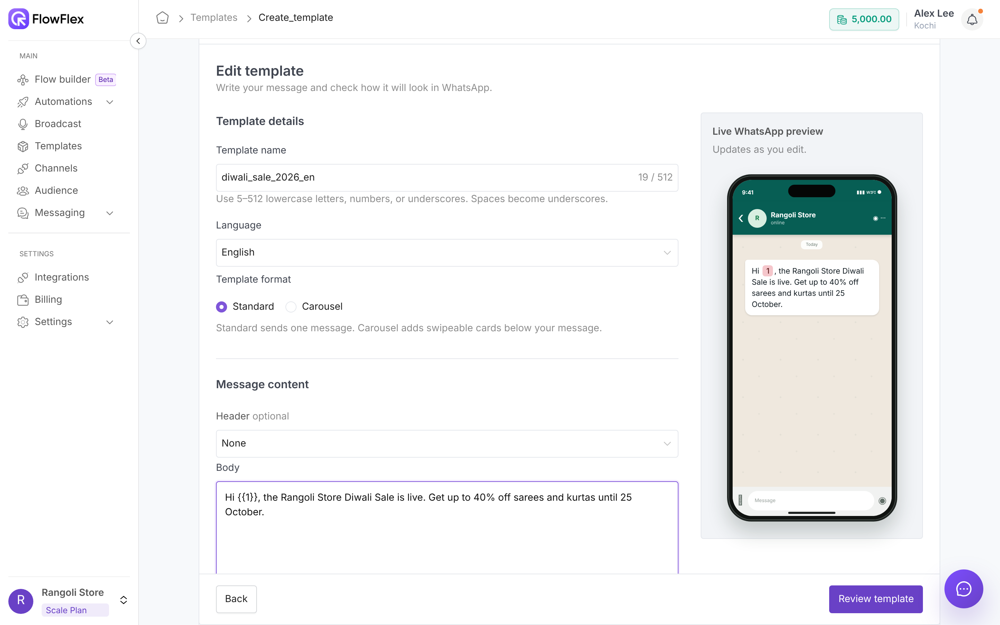
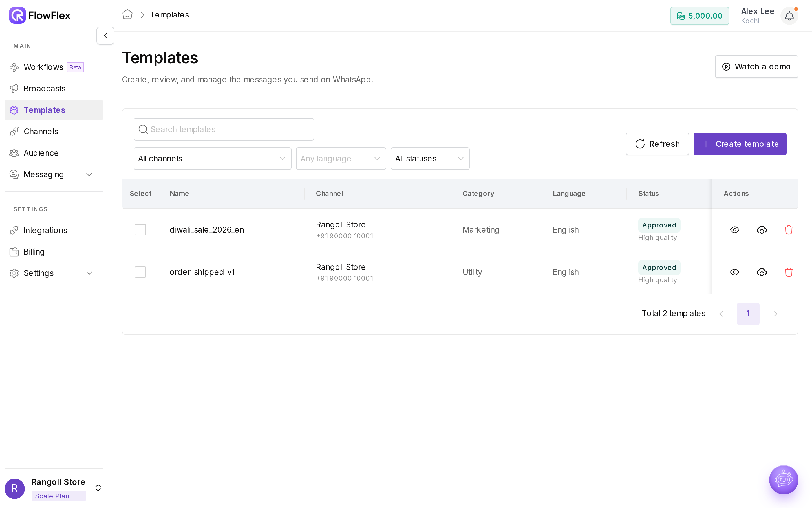

# Create a template

A template is a message Meta has approved in advance. You need one to message customers outside the 24-hour window after they last wrote to you, and for every broadcast. Each template belongs to one channel's WhatsApp Business Account (WABA), so another WABA can't use it. Meta usually reviews a template within minutes, but it can take up to 24 hours.

For the Diwali sale, Jordan Brown, Rangoli Store's marketing manager, creates `diwali_sale_2026_en`: a Marketing template with a festive banner, a **Shop now** link and an opt-out button. It is approved within minutes, and the team builds the broadcast the same afternoon.

Read the [Template guidelines](template-guidelines.md) before you submit. They cover the most common reasons Meta rejects a template.

## Create the template

Go to **Templates** → **Create template**. The wizard has four steps: **Select channel**, **Set up template**, **Edit template** and **Submit for review**.

### 1. Select channel

Pick a **Connected** channel. The template is created in that channel's WABA.

### 2. Set up template

1.  Choose a **Template category**. Meta charges by category, and it re-categorises templates whose content doesn't match the category you chose.

    * **Marketing:** promotions, offers, launches, re-engagement and newsletters, such as a sale announcement or an abandoned cart with a discount. Send only to customers who have opted in.
    * **Utility:** updates about something the customer already did or bought, such as an order confirmation, shipping update or appointment reminder. One promotional sentence makes it Marketing.
    * **Authentication:** one-time passwords only. Meta fixes the content.

    For worked examples, see [Choose the right category](../broadcasts/broadcast-guidelines.md#choose-the-right-category).
2. Enter a **Template name**: lowercase letters, numbers and underscores only. Spaces become `_`. Use at least 5 characters and keep it under 100. Names must be unique in the WABA, so use a pattern such as `diwali_sale_2026_en` or `order_shipped_v1`.
3. Pick the **Language** of the content. For several languages, create one template per language with the same name.
4. For a Marketing template, pick a **Template format**: **Standard** (one message) or **Carousel** (2 to 10 swipeable cards).

### 3. Edit template

Write the message. The preview shows how it will look on the customer's phone.

| Part    | Required | Limits in FlowFlex                                                                                                                                                                                      |
| ------- | -------- | ------------------------------------------------------------------------------------------------------------------------------------------------------------------------------------------------------- |
| Header  | No       | **None**, **Text** (60 characters, up to one variable `{{1}}`), **Image** (JPEG/PNG, 5 MB), **Video** (MP4/3GPP, 16 MB), **Document** (PDF/Office/txt, 100 MB) or **Location** (filled in at send time) |
| Body    | Yes      | 1,024 characters. Variables `{{1}}` to `{{15}}`, numbered only.                                                                                                                                         |
| Footer  | No       | 60 characters, no variables                                                                                                                                                                             |
| Buttons | No       | Up to 10 buttons, 25 characters of text each. More than 3 show as a list.                                                                                                                               |

Every variable needs a sample value. Meta reviews the template using these samples, so make them realistic: `John` for a name, `ORD-48213` for an order ID, never `test` or `abc`.

#### Buttons

| Button                                            | Limit             | Notes                                                                                                                                                                                |
| ------------------------------------------------- | ----------------- | ------------------------------------------------------------------------------------------------------------------------------------------------------------------------------------ |
| Quick reply → **Marketing opt-out** (Recommended) | 1, Marketing only | The button text is your STOP keyword. Tapping it unsubscribes the contact automatically. Add it to every Marketing template.                                                         |
| Quick reply → **Custom**                          | –                 | Free text such as "Yes, interested". Replies arrive in **Conversations**.                                                                                                            |
| **Visit Website**                                 | 2                 | **Static** URL, or **Dynamic** URL that adds `{{1}}` at the end, for example `https://rangoli.example/order/{{1}}`. FlowFlex converts links to a tracked short link to count clicks. |
| **Call Phone Number**                             | 1                 | Include the country code.                                                                                                                                                            |
| **Copy offer Code**                               | 1, Marketing only | Up to 15 characters. Not shown on WhatsApp Web.                                                                                                                                      |

#### Carousel

A carousel has 2 to 10 cards. All cards use the same header type (all images or all videos) and the same buttons as Card 1, with 1 or 2 buttons per card. A carousel has no header, footer or buttons outside the cards.

#### Authentication

The text is fixed. You can add a security recommendation and a code expiry time (1 to 90 minutes). A copy-code button is added automatically.

### 4. Submit for review

Check the preview and click **Submit for review**. The template appears in **Templates** with the status **In Review**.

## Track the review

FlowFlex receives status changes from Meta automatically. Click **Sync from Meta** on a row, or **Refresh**, to pull them sooner.

| Status    | Meaning                                                                           | What to do                                                        |
| --------- | --------------------------------------------------------------------------------- | ----------------------------------------------------------------- |
| In Review | Meta is reviewing it                                                              | Wait. You can't broadcast it yet.                                 |
| Approved  | Ready to use. Quality shows **High**, **Medium**, **Low** or **Quality pending**. | Broadcast it, and watch for a quality drop.                       |
| Rejected  | Meta refused it                                                                   | Read the reason, fix the content, and submit it under a new name. |
| Paused    | Paused after negative feedback or low read rates                                  | Running broadcasts pause. Rework the content and audience.        |
| Disabled  | Disabled after repeated low quality                                               | Create a new, improved template.                                  |

Statuses follow [Meta – Template fundamentals](https://developers.facebook.com/documentation/business-messaging/whatsapp/templates/overview). To understand quality ratings and how long a pause lasts, see [Template quality](../broadcasts/broadcast-guidelines.md#template-quality).

## See also

* [Template guidelines](template-guidelines.md)
* [Send a broadcast](../broadcasts/send-broadcast.md)
* [Connect a WhatsApp channel](connect-channel.md)
